# 1Halal Store — Task List

## Storefront

- [x] **#28 — Storefront: Implement Google Analytics**
  No description.

  **Files to investigate:**
  - No Google Analytics or third-party tracking integration currently exists in the codebase. This is a new feature, not a bugfix.
  - Related storefront files: `resources/views/layouts/storefront.blade.php` (main layout — GA snippet would go in `<head>`), `resources/views/partials/portal-header.blade.php` (shared header), `routes/web.php` (storefront routes), `.env` / `.env.example` (for `GOOGLE_ANALYTICS_ID` env var).

---

## Admin Onboarding & Settings

- [x] **#43 — Dispute Hold Days cannot be edited**
  I tried updating the value to 1 but it goes back to 7 on update.

  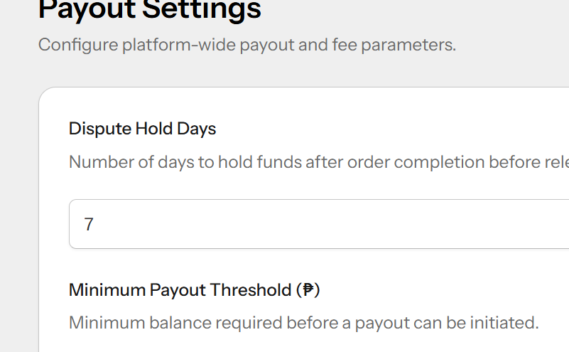

  **Files to investigate:**
  - `app/Livewire/Admin/PayoutSettings.php` — Livewire component, `save()` at line 44, `mount()` loading at line 71
  - `resources/views/livewire/admin/payout-settings.blade.php` — Blade form with `wire:model="dispute_hold_days"`
  - `app/Models/PayoutSetting.php` — model with `getDisputeHoldDays()` and generic `get()`/`set()`
  - `app/Http/Controllers/Api/V1/Admin/PayoutSettingsController.php` — API update endpoint
  - `app/Http/Requests/Admin/UpdatePayoutSettingsRequest.php` — validation rules
  - `database/migrations/2026_08_24_045942_create_payout_settings_table.php` — table schema
  - `database/seeders/PayoutSettingsSeeder.php` — default seed value (7)
  - `tests/Feature/PayoutSettingsTest.php` — existing payout settings tests

  **Likely cause:** The Livewire `save()` method or how the value gets persisted/read back may have a type mismatch, or the `PayoutSetting::set()` call isn't writing the value correctly.

---

## Product Management

- [x] **#30 — Should be auto-upload on file select**
  **Issue:** On the `/hub/onboarding` document steps, the upload fields require users to manually click an "Upload" button after selecting a file. The upload fields should be updated to a droppable area that auto-uploads immediately upon file selection.

  **Files to investigate:**
  - `resources/views/livewire/company-hub/steps/step-5-documents.blade.php` (Remove the "Upload" button and wire auto-upload logic)
  - `app/Livewire/CompanyHub/OnboardingWizard.php` (Implement hook to auto-trigger `uploadDocument`)
  
  *(Note: This issue was moved from Product Management to Admin Onboarding conceptually, but keeping it here to preserve file structure)*

  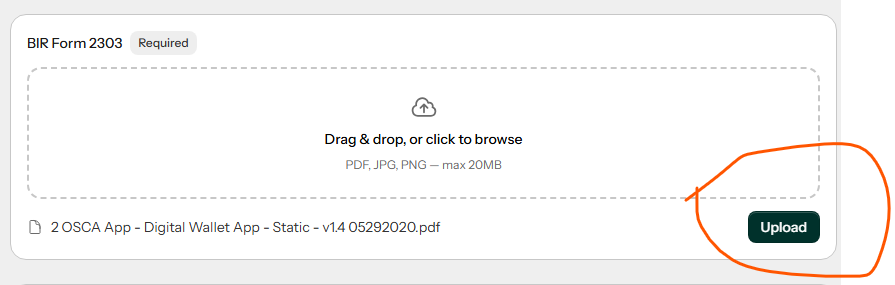

  **Proposed plan:**
  - **Root cause:** The `step-5-documents.blade.php` view uses a manual `flux:button` to trigger the `uploadDocument()` method, rather than reacting automatically to the `wire:model` update on the file input.
  - **Proposed change:** Remove the manual "Upload" button from `step-5-documents.blade.php`. In `OnboardingWizard.php`, add a Livewire lifecycle hook `updatedDocumentUploads($value, $key)` to automatically trigger `uploadDocument($key)` when a file is selected.
  - **Conventions:** Follows Livewire's `updated{Property}` hook convention for auto-saving or reacting to property changes.
  - **Edge cases & risks:** Need to ensure the UI shows a loading state immediately after file selection while the upload processes.
  - **Tests:** Update or add tests in `tests/Feature/CompanyHub/OnboardingWizardTest.php` to assert that updating the documentUploads property automatically stores the document without requiring an explicit action call.

- [x] **#31 — Publish/archive error when toggled**
  **Issue:** Rapidly clicking the Publish/Archive button on the products list triggers a Livewire error. Additionally, the button is not prominent enough for users to easily spot. The button needs a more visible design and proper request debouncing/disabling during loading states.

  **Files to investigate:**
  - `app/Livewire/CompanyHub/ProductList.php` (lines 33-55) - `confirmToggleStatus` and `toggleStatus` methods where the state change is triggered.
  - `resources/views/livewire/company-hub/product-list.blade.php` (lines 117-134, 161-190) - The ghost button that triggers the action and the confirmation modals.

  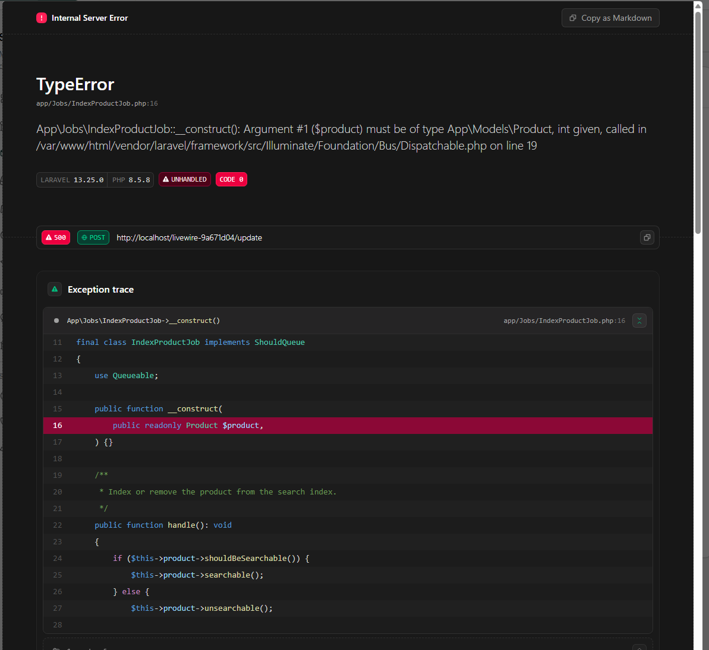
  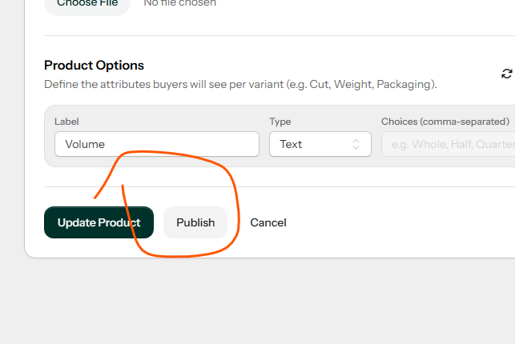

---

  **Proposed plan:**
  - **Root cause:** Rapidly clicking the Publish/Archive button triggers `toggleStatus()` multiple times. The state `confirmingProductId` might not reset instantly or the request fires multiple times without `wire:loading.attr="disabled"` on the ghost button in the table. The ghost button design is also too subtle.
  - **Proposed change:** In `product-list.blade.php`, change the toggle button variant from `ghost` to `subtle` or `filled` for better visibility. Add `wire:loading.attr="disabled"` and `wire:target="confirmToggleStatus"` to the button to prevent multiple clicks while the modal opens. Ensure the confirmation modal buttons also properly disable during `toggleStatus`.
  - **Conventions:** Follows Flux UI conventions for button variants and Livewire's `wire:loading` for debouncing.
  - **Edge cases & risks:** None. Standard UI/UX debounce fix.
  - **Tests:** Add a Pest test in `tests/Feature/CompanyHub/ProductListTest.php` to verify status toggling works and UI components are rendered correctly.

## RFQ (Request for Quotation)

- [x] **#32 — Bad RFQ user experience**
  **Issue:** Buyers cannot proceed with sending an RFQ if their buyer profile is incomplete. Currently, they are shown an error message with a link that redirects them away from the RFQ page to the profile edit page, causing them to lose any RFQ data they have already entered. The system should instead present a modal directly on the RFQ form page to capture the required profile information without losing the entered RFQ state.

  **Files to investigate:**
  - `app/Livewire/Account/RfqCreateForm.php` (lines 79-85) - Validation logic that currently adds an error message if the buyer profile is missing.
  - `resources/views/livewire/account/rfq-create-form.blade.php` (lines 127-135) - The view template that renders the warning banner and link to the profile page.
  - `app/Livewire/Account/BuyerProfileForm.php` and `resources/views/livewire/account/buyer-profile-form.blade.php` - Existing profile form components that may need to be adapted or wrapped in a modal.

  **Proposed plan:**
  - **Root cause:** `app/Livewire/Account/RfqCreateForm.php` returns a validation error when the buyer profile is incomplete, and `rfq-create-form.blade.php` renders a link that navigates away to the profile page, losing the form state.
  - **Proposed change:** Embed the existing `BuyerProfileForm` component (or a specialized version) inside a `<flux:modal>` directly on `rfq-create-form.blade.php`. When the user profile is incomplete, automatically open this modal. After the profile is successfully saved, dispatch an event to close the modal and retry the RFQ submission without navigating away.
  - **Conventions:** Follows Livewire component nesting and Flux modal usage.
  - **Edge cases & risks:** Need to ensure the `BuyerProfileForm` can operate inside a modal without conflicting with the parent form's state or triggering unwanted full-page redirects on its own save.
  - **Tests:** Add a Pest test verifying that submitting an RFQ with an incomplete profile triggers the modal state instead of redirecting.

  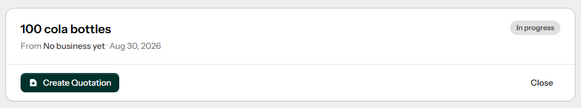

  **Proposed plan:**
  - **Root cause:** In `app/Livewire/Account/RfqDetail.php` (line 151), the `closeRfq` cascade logic explicitly uses `whereDoesntHave('quotations', fn ($q) => $q->where('status', 'awarded'))`. This intentionally excludes sellers with awarded quotations from being marked as 'closed'.
  - **Proposed change:** Remove the `whereDoesntHave` clause so that ALL active seller recipients (except those already in `no_bid`) are transitioned to `closed` when the buyer closes the parent RFQ.
  - **Conventions:** Matches standard Eloquent mass updates.
  - **Edge cases & risks:** Need to ensure that closing an awarded recipient doesn't break their ability to proceed with the order. If the system expects awarded recipients to remain "open", this requires clarification (Needs clarification: Should awarded recipients be marked 'closed', or should they just be prevented from manually closing as described in #38?). Assuming we should close them.
  - **Tests:** Update `tests/Feature/RfqTest.php` to assert that closing a buyer RFQ cascades the 'closed' status to all recipients regardless of quotation status.

- [x] **#38 — RFQ is marked as declined (no bid) despite having an awarded quotation**
  **Issue:** If a seller's RFQ remains open after the buyer closes it (due to having an awarded quotation), the seller can manually click "Decline/Close", which updates their status to `no_bid`. Sellers with an awarded quotation should not be able to manually decline/close the RFQ.

  **Files to investigate:**
  - `app/Livewire/CompanyHub/RfqDetail.php` - The `closeRfq` method and the conditions for showing the close button.
  - `resources/views/livewire/company-hub/rfq-detail.blade.php` - Hide or disable the decline button if awarded or parent closed.

  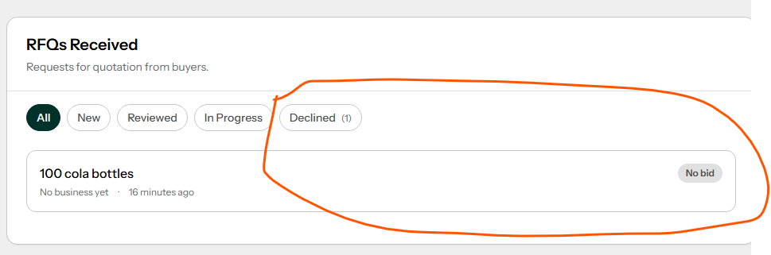

  **Proposed plan:**
  - **Root cause:** `app/Livewire/CompanyHub/RfqDetail.php` allows the seller to trigger `closeRfq()` (which sets status to `no_bid`) even if they have already had a quotation awarded by the buyer. The view `rfq-detail.blade.php` also renders the Decline button without checking for awarded quotations.
  - **Proposed change:** In `rfq-detail.blade.php`, conditionally hide or disable the "Decline" button if `$rfqRecipient->quotations->contains('status', 'awarded')`. Additionally, in `RfqDetail.php`'s `closeRfq()` method, throw an authorization exception if an awarded quotation exists.
  - **Conventions:** Standard Livewire authorization and Blade conditionals.
  - **Edge cases & risks:** Ensure the quotations relationship is eager-loaded to prevent N+1 queries when checking the condition.
  - **Tests:** Add a test verifying that a seller cannot close an RFQ after their quotation has been awarded.

- [x] **#51 — Seller cannot view RFQ attachment**
  **Issue:** Sellers get a 403 Forbidden error when trying to view an RFQ attachment. The media authorization logic only allows the original uploader (buyer) or an admin, failing to grant access to the RFQ recipients.

  **Files to investigate:**
  - `routes/web.php` (lines ~24-58) - The `media.view` route authorization logic needs to allow RFQ recipients to view the media.
  - `resources/views/livewire/company-hub/rfq-detail.blade.php` - Where the seller clicks the attachment link.

  **Proposed plan:**
  - **Root cause:** The `media.view` route in `routes/web.php` explicitly checks if the user is an admin or the original uploader (the buyer). It fails to account for RFQ attachments where the seller (recipient) needs access.
  - **Proposed change:** Update the authorization logic in `routes/web.php` for `media.view`. Add a condition: check if the media is attached to any RFQ (`$media->rfqs()->exists()`) where the current user's shop is a recipient (`$rfq->recipients()->where('shop_id', $user->shop->id)->exists()`).
  - **Conventions:** Matches the existing inline authorization checks for disputes in the same route.
  - **Edge cases & risks:** We need to ensure the relationship between Media and Rfq exists and can be queried efficiently without leaking attachments to non-recipient sellers.
  - **Tests:** Add an endpoint test verifying that an RFQ recipient can successfully GET the `media.view` route for an attached file, while a non-recipient gets 403.

## Orders & Fulfillment

- [x] **#35 — Order price does not match quotation price**
  **Issue:** When an order is created from a quotation, the system incorrectly uses the product variant's default price instead of the custom negotiated price from the quotation item.

  **Files to investigate:**
  - `app/Actions/CreateOrderAction.php` (lines ~218) - The `unit_price` resolution logic needs to prioritize `$quotationItem->unit_price` over `$variant->price`.

  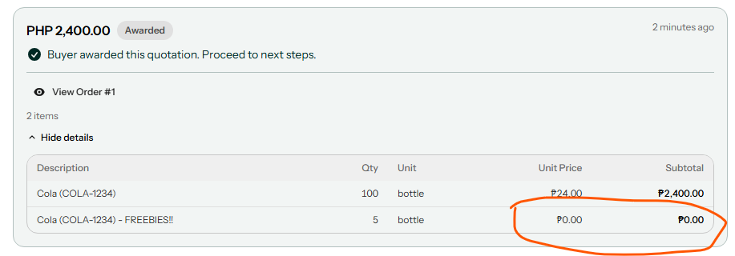
  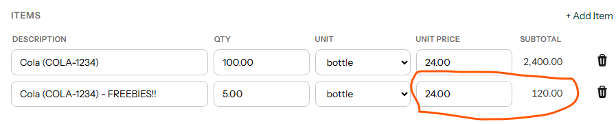

  **Proposed plan:**
  - **Root cause:** `CreateOrderAction::resolveItemData()` at line 218 of `app/Actions/CreateOrderAction.php` — in the Priority 2 branch (variant_id is set, no variant_snapshot), the returned `unit_price` is `(string) $variant->price` (the live catalog price) instead of the negotiated price stored on the quotation item. Priority 1 (snapshot present) correctly uses `$quotationItem->variant_snapshot['unit_price'] ?? $quotationItem->unit_price`, and Priority 3 (freeform) correctly uses `$quotationItem->unit_price`. Only Priority 2 is wrong.
  - **Proposed change:** In `app/Actions/CreateOrderAction.php`, change line 218 from `'unit_price' => (string) $variant->price,` to `'unit_price' => (string) $quotationItem->unit_price,`. The `$variant` lookup is still needed for the `unit` field (`$variant->unit` on line 217), but the price must come from the quotation item's negotiated `unit_price`. No other files need to change.
  - **Conventions:** All three fallback paths already use `(string)` casting for `unit_price` to produce a consistent decimal string. The freeform and snapshot paths both pull price from `$quotationItem->unit_price`, making this change consistent across all priorities. The `QuotationItem` model casts `unit_price` as `'decimal:2'`, so it is always a numeric string — no additional formatting needed.
  - **Edge cases & risks:** If `$variant` is found but has been deleted or price was legitimately changed, the old behaviour silently billed catalog price. The new behaviour always honours the agreed quotation price, which is the correct business rule. The only risk is if tests assert the old (wrong) `$variant->price` value — check `tests/Feature/CreateOrderActionTest.php`: the existing test for Priority 2 (variant_id path) is absent from the test file (only freeform and snapshot paths are tested), so no existing test will break. The existing snapshot test at line 47 asserts `unit_price` = `'99.99'` from the snapshot, which is unaffected.
  - **Tests:** Add a new test to `tests/Feature/CreateOrderActionTest.php`: create a `QuotationItem` with a `variant_id` pointing to a `ProductVariant` whose `price` differs from the quotation item's `unit_price` (e.g. variant catalog price = `500.00`, quotation `unit_price` = `350.00`). Assert that the resulting order item's `unit_price` is `'350.00'` (not `'500.00'`), and that `unit` is copied from the variant. Also assert that `subtotal` = `quantity × 350.00`.

  **Proposed plan:**
  - **Root cause:** In `app/Actions/CreateOrderAction.php` (line ~218), the `resolveItemData` method's Priority 2 fallback incorrectly overrides the negotiated quotation price with the default catalog `$variant->price`.
  - **Proposed change:** Modify `resolveItemData` so that it always prioritizes `$quotationItem->unit_price` (the negotiated price) over `$variant->price`, using the variant only to backfill missing descriptions or unit types.
  - **Conventions:** Follows the established DTO/array mapping pattern in the action.
  - **Edge cases & risks:** Ensure that any calculations relying on this price (e.g., subtotal) correctly handle string/bcmath casting.
  - **Tests:** Update `CreateOrderActionTest` to assert that the resulting order items retain the custom negotiated price from the quotation rather than the catalog price.

- [x] **#36 — Null product id column in order_items table**
  **Issue:** The `product_id` is missing when mapping quotation items to order items during order creation.

  **Files to investigate:**
  - `app/Actions/CreateOrderAction.php` - Mapping logic needs to resolve and set `product_id` (likely from the variant or quotation).

  **Proposed plan:**
  - **Root cause:** The `CreateOrderAction.php` maps `quotation_items` to `order_items` but completely omits the `product_id` field in the insertion array.
  - **Proposed change:** Update `CreateOrderAction.php` mapping logic to resolve and inject the `product_id`. This can be pulled via `$quotationItem->variant->product_id` (or from snapshot data) and added to the `order_items` payload.
  - **Conventions:** Standard Eloquent insertion.
  - **Edge cases & risks:** Freeform quotation items without a variant might not have a `product_id`, so the database column must remain nullable (or handled gracefully).
  - **Tests:** Assert in `CreateOrderActionTest` that the `product_id` is successfully populated on the resulting `OrderItem`.

---

**All the rest are deferred due to change of requirements**

- [ ] **#39 — Early Confirm Receive CTA**
  **Issue:** The "Confirm Receive" button is visible when an order is in the "shipped" state, but it should only be available when the fulfillment status is "delivered".

  **Files to investigate:**
  - `resources/views/livewire/account/orders/order-list.blade.php` (line ~81) - Condition needs to check `$order->fulfillment_status === 'delivered'` instead of just `$tab === 'to_receive'`.
  - `resources/views/livewire/account/orders/order-detail.blade.php` - Check the button visibility here too.

  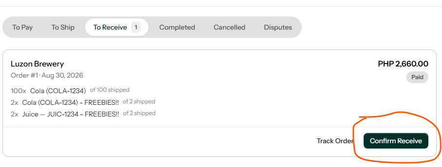

  **Proposed plan:**
  - **Root cause:** In `resources/views/livewire/account/orders/order-list.blade.php`, the "Confirm Receive" button is rendered based entirely on `$tab === 'to_receive'`, which includes both 'shipped' and 'delivered' states.
  - **Proposed change:** Update the Blade condition to explicitly check that at least one fulfillment has a status of 'delivered' (e.g., `$order->fulfilments->contains('status', 'delivered')`) before showing the button. Apply the same check in `order-detail.blade.php` if present.
  - **Conventions:** Standard Blade conditionals and Eloquent collection methods.
  - **Edge cases & risks:** Need to ensure the `fulfilments` relationship is eager-loaded to avoid N+1 queries in the list view.
  - **Tests:** Add a UI/Feature test verifying that the "Confirm Receive" button is hidden for shipped orders and visible for delivered orders.

- [ ] **#42 — Mark Returned does nothing**
  **Issue:** Marking a fulfillment as returned updates the database status, but the UI remains stuck on "shipped", the buyer is not notified, and no refund process is initiated.

  **Files to investigate:**
  - `app/Livewire/CompanyHub/Fulfilment/FulfilmentPanel.php` (line ~127) - The `returned_to_seller` status update logic.
  - Order status and fulfillment state machine logic.
  - Notifications and refund logic.

  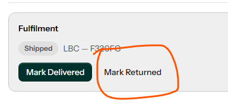
  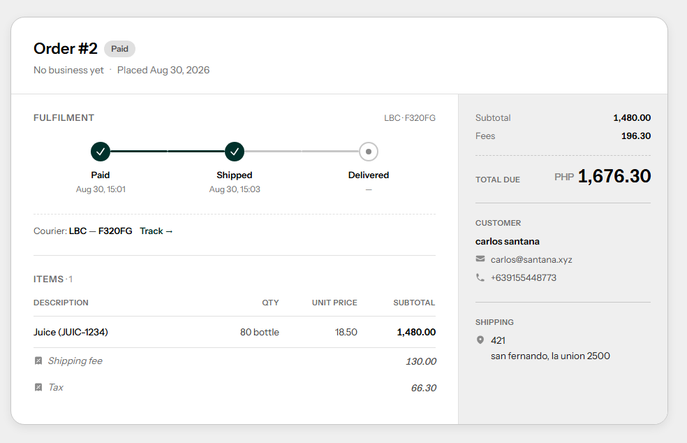
  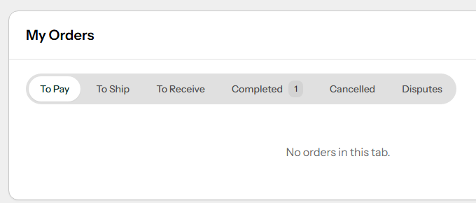
  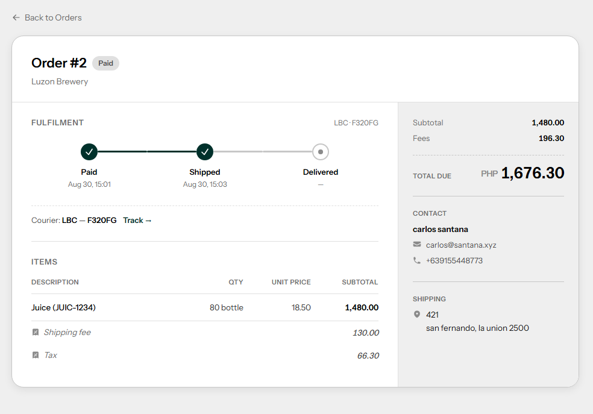

  **Proposed plan:**
  - **Root cause:** `FulfilmentPanel.php` sets the fulfilment status to `returned_to_seller` but lacks the surrounding state machine logic to update the parent Order's status, notify the buyer, or handle refunds.
  - **Proposed change:** In `FulfilmentPanel.php`, after marking returned, update the Order status (e.g., to `refunded` or a dedicated `returned` state), dispatch an `OrderReturnedNotification` to the buyer, and hook into the refund action.
  - **Conventions:** Follows the existing event/notification dispatch patterns used in `OrderList::confirmReceived`.
  - **Edge cases & risks:** Needs clarification on whether "Mark Returned" should automatically trigger a full refund immediately, or just queue it for admin review.
  - **Tests:** Add a feature test for the return flow ensuring all side-effects (order status, notifications, refunds) are triggered.

- [ ] **#44 — Refunded state kind of misleading**
  **Issue:** The system shows a "Refunded" status even when only a partial refund was issued. The UI should distinguish between "Completed - Refunded" and "Completed - Partially refunded" to clarify that the order is closed.

  **Files to investigate:**
  - Status display components (e.g. `resources/views/components/hs-status-pill.blade.php`).
  - Order detail and list views for both buyer and seller.

  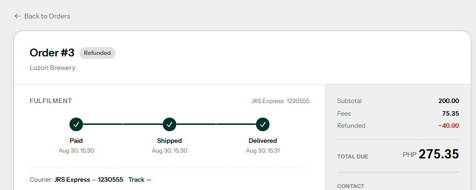

  **Proposed plan:**
  - **Root cause:** The status display components (e.g., `hs-status-pill.blade.php`) map the `refunded` enum value to a generic "Refunded" label without checking the actual refund amount versus the order total.
  - **Proposed change:** Update the status pill and order detail views to compare `$order->refund_amount` (if available) against `$order->total`. If it's a partial refund, display "Completed - Partially Refunded"; otherwise, display "Completed - Refunded".
  - **Conventions:** Follows standard Blade component conditional logic.
  - **Edge cases & risks:** Need to ensure the refund amount is always cast correctly for float/bcmath comparisons.
  - **Tests:** Add unit tests for the status display logic covering both full and partial refund scenarios.

- [ ] **#52 — Order items should be from catalog**
  **Issue:** When clicking "Add Item" in the order builder, the seller should be able to select from published products and variants rather than freeform text entry. 

  **Files to investigate:**
  - `app/Livewire/CompanyHub/Orders/OrderBuilder.php` - The `searchResults` method already exists to query products, but needs to be wired to the UI.
  - `resources/views/livewire/company-hub/orders/order-builder.blade.php` - Implement the dropdown/search UI.

  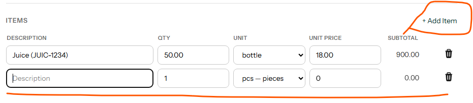

  **Proposed plan:**
  - **Root cause:** The `OrderBuilder` blade view provides freeform text inputs for "Add Item" rather than utilizing the existing `searchResults` computed property which queries the seller's catalog.
  - **Proposed change:** Refactor the "Add Item" UI in `order-builder.blade.php` to include an autocomplete/dropdown component bound to `$productSearch`. Selecting a product variant should automatically populate the item's unit, price, and description fields.
  - **Conventions:** Follows existing Alpine/Livewire autocomplete patterns in the codebase.
  - **Edge cases & risks:** Must ensure that legacy or custom freeform entries are still supported if the business logic requires custom line items that don't exist in the catalog. (Needs clarification if freeform items should be strictly prohibited).
  - **Tests:** Add a Livewire component test verifying that selecting a catalog item correctly maps its data into the `items` array.

## Dashboard

- [ ] **#41 — Inconsistent stat**
  **Issue:** Dashboard summary stats (e.g., "To Receive", "Completed") differ from the counts on the actual orders page due to mismatched queries.

  **Files to investigate:**
  - `app/Livewire/Account/Dashboard.php` - The `statusCounts` logic is missing exclusions for completed/cancelled orders for "to_receive".
  - `app/Livewire/Account/Orders/OrderList.php` - The `tabCounts` logic is the source of truth to sync with.

  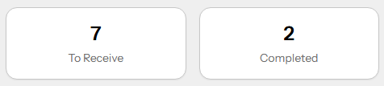
  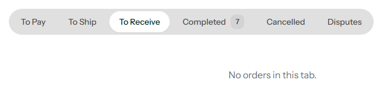
  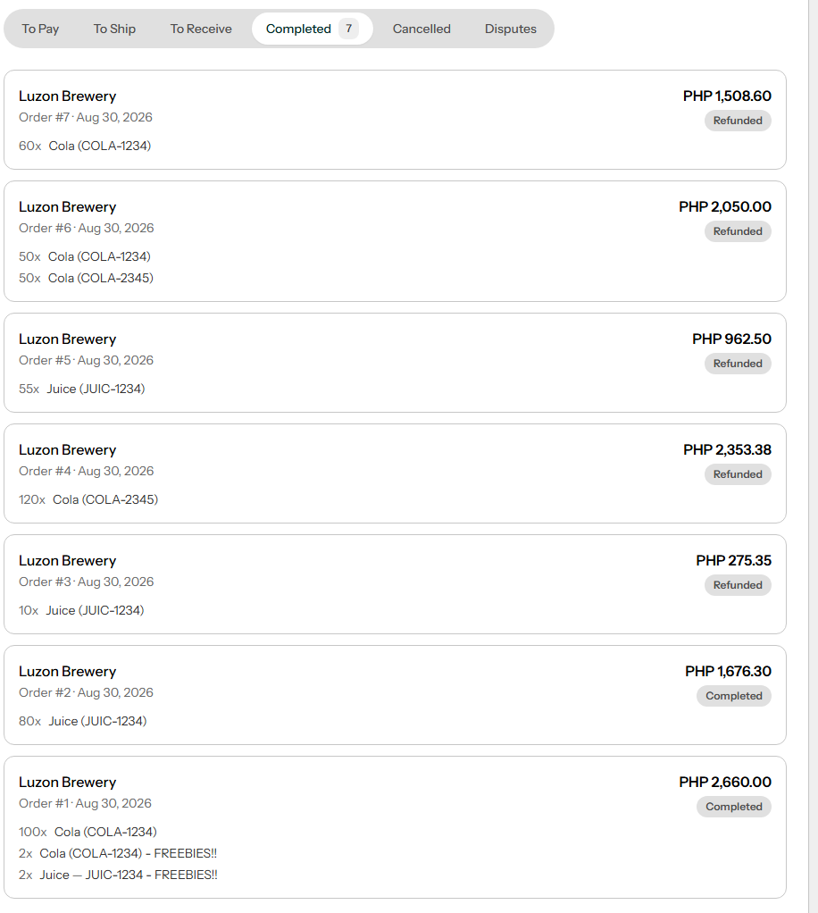

  **Proposed plan:**
  - **Root cause:** `Dashboard::statusCounts()` (line 37–39) builds the `to_receive` count with only `whereHas('fulfilments', fn($f) => $f->whereIn('status', ['shipped','delivered']))`, with no guard on the order's own `status` column. This means orders whose status has already advanced to `completed`, `cancelled`, or `refunded` are still counted as "To Receive" if any of their fulfilments are in `shipped`/`delivered`. `OrderList::tabCounts()` (line 54–55) is the authoritative query and adds `whereNotIn('status', ['completed','cancelled','refunded'])` before the `whereHas` check. The `completed` card also diverges: Dashboard counts only `status = 'completed'` (line 40–41), while `tabCounts` (line 56) uses `whereIn('status', ['completed','refunded'])`, so refunded orders are missed on the dashboard.
  - **Proposed change:** In `app/Livewire/Account/Dashboard.php`, update `statusCounts()` to mirror `tabCounts()` exactly: (1) change the `to_receive` query to chain `->whereNotIn('status', ['completed','cancelled','refunded'])->whereHas('fulfilments', fn($f) => $f->whereIn('status', ['shipped','delivered']))`, and (2) change the `completed` query from `->where('status','completed')` to `->whereIn('status', ['completed','refunded'])`. No other files need to change.
  - **Conventions:** Other `#[Computed]` query methods in the codebase use the same clone-and-count pattern with `Auth::id()` scope. The fix keeps the method structure identical and just aligns the SQL predicates with the existing `OrderList` source of truth. No new model scopes or helpers are needed.
  - **Edge cases & risks:** Orders in `refunded` status with a `shipped`/`delivered` fulfilment were previously double-counted (once in `to_receive`, once missed in `completed`). After the fix both counts will be correct simultaneously — verify no test asserts the old, wrong values. The `#[Computed]` cache means stale values persist within a single request but that is already the case and is fine.
  - **Tests:** Extend `tests/Feature/BuyerDashboardTest.php` — add a test that creates an order with `status = 'completed'` and a `shipped` fulfilment and asserts `to_receive` count is 0; add another that creates a `refunded` order and asserts it appears in `completed` count; assert an order in `shipped` status with a `shipped` fulfilment is counted in `to_receive`. The existing `status counts reflect the buyer orders` test should continue to pass unchanged.
- [ ] **#45 — Dashboard stats click issue**
  **Issue:** Clicking a dashboard stat card navigates to the orders page but doesn't activate the correct tab. The URL includes the query parameter `?tab=...`, but Livewire is ignoring it.

  **Files to investigate:**
  - `app/Livewire/Account/Orders/OrderList.php` (and CompanyHub equivalent) - Add `#[Url]` attribute to the `$tab` property to track query string state.

  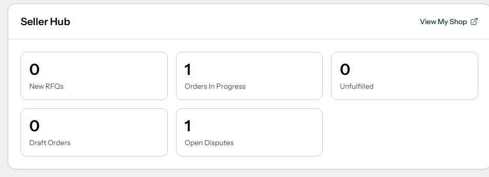
  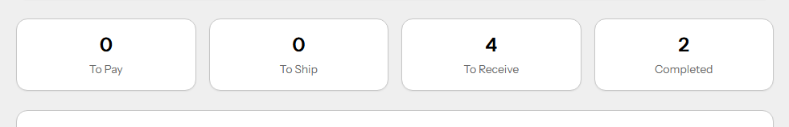

  **Proposed plan:**
  - **Root cause:** `OrderList::$tab` (line 22 of `app/Livewire/Account/Orders/OrderList.php`) is declared as a plain public property (`public string $tab = 'to_pay'`) without the `#[Url]` PHP attribute. Livewire only reads query-string parameters into a property when `#[Url]` is present on mount, so navigating to `/account/orders?tab=to_receive` leaves `$tab` at its default `'to_pay'`. The seller equivalent, `OrderQueue::$tab` (line 24 of `app/Livewire/CompanyHub/Orders/OrderQueue.php`), has the same problem — no `#[Url]` — but the seller hub dashboard blade (line 21) links all stat cards to `route('hub.orders.index')` without any `?tab=...` parameter, so the seller dashboard does not currently attempt to deep-link into a specific tab. The buyer dashboard blade (line 28) correctly appends `['tab' => $card['tab']]` to the route, making this a buyer-only observable bug right now.
  - **Proposed change:** (1) In `app/Livewire/Account/Orders/OrderList.php`, add `use Livewire\Attributes\Url;` (it is already imported elsewhere in the file — check; if not, add it) and decorate `$tab` with `#[Url]`: `#[Url] public string $tab = 'to_pay';`. (2) Optionally apply the same fix to `app/Livewire/CompanyHub/Orders/OrderQueue.php` (`#[Url] public string $tab = 'all';`) so that if the seller hub dashboard ever gains tab-specific deep-links the behaviour is already correct. (3) No blade changes are needed for the buyer dashboard — the `['tab' => $card['tab']]` route parameter is already being passed correctly on line 28 of `resources/views/livewire/account/dashboard.blade.php`.
  - **Conventions:** The project already uses `#[Url]` on Livewire properties in `RfqCreateForm.php` (lines 26, 33, 36) with `use Livewire\Attributes\Url` import. The same pattern should be applied here with no additional helpers or boilerplate.
  - **Edge cases & risks:** Adding `#[Url]` means the `tab` value will be reflected in the browser URL whenever the user clicks a tab inside `OrderList`, which is desirable but is a behaviour change (shareable/bookmarkable URLs per tab). Ensure `updatedTab()` (line 24–27) still fires on tab click — it will, since `$tab` remains a public property. Validate that the default `'to_pay'` does not cause a URL pollution issue (Livewire only writes `?tab=to_pay` when it differs from the default only if `#[Url(history: true)]` is used; the plain `#[Url]` only syncs on mount, which is the desired behaviour here).
  - **Tests:** Add a test in `tests/Feature/BuyerDashboardTest.php` (or a new `OrderListTabTest.php`) that uses `Livewire::withQueryParams(['tab' => 'to_receive'])->test(OrderList::class)` and asserts `$component->get('tab') === 'to_receive'`. Also assert that without the query param the default `'to_pay'` is used. For the seller, a parallel test with `OrderQueue` and `tab = 'draft'`.
## Chat & Messaging

- [ ] **#34 — Add message icon and count badge**
  **Issue:** The portal header needs a message icon with an unread count badge for quick access to the chat inbox.

  **Files to investigate:**
  - `resources/views/partials/portal-header.blade.php` - The shared header navigation.
  - The Livewire component responsible for the unread message count (if any exists).

  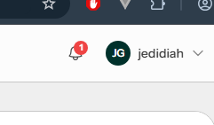

  **Proposed plan:**
  - **Root cause:** The portal header navigation view (`portal-header.blade.php`) currently just has a static link/icon for messages without polling or calculating the unread count.
  - **Proposed change:** Create a lightweight Livewire component (e.g., `UnreadMessageBadge`) that computes the unread count for the authenticated user based on `Conversation` or `Message` read receipts, and embed it into the portal header.
  - **Conventions:** Extracting this to a dedicated Livewire component keeps the header clean and allows `wire:poll` or event listening for real-time updates.
  - **Edge cases & risks:** Frequent polling could impact performance; we should ensure the query is highly optimized or uses cache.
  - **Tests:** Add a Livewire component test to verify the badge displays the correct unread integer and updates when new messages arrive.

- [ ] **#40 — Duplicate chat entries?**
  **Issue:** The chat inbox is showing duplicate entries for the same conversation. 

  **Files to investigate:**
  - `app/Livewire/Account/ChatInbox.php` and `app/Livewire/CompanyHub/ChatInbox.php` - Query logic for fetching inbox threads.
  - Underlying `Conversation` or `Message` models for missing `DISTINCT` or `GROUP BY` logic.

  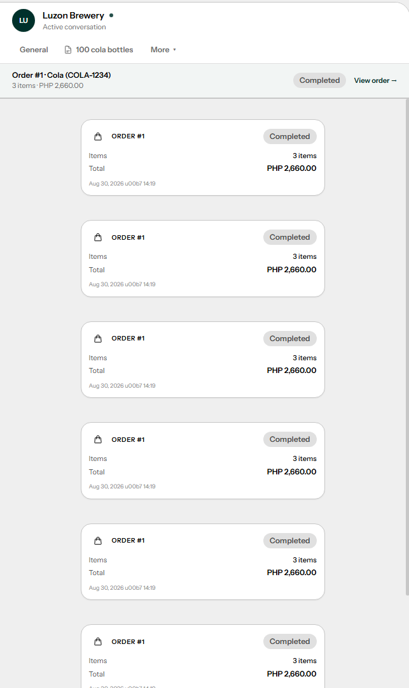

  **Proposed plan:**
  - **Root cause:** The query fetching the chat inbox threads (likely in `ChatInbox.php` or `Conversation` model scopes) joins related tables (like messages or participants) without a `DISTINCT` or grouping clause, returning multiple rows for the same conversation.
  - **Proposed change:** Update the Eloquent query in the inbox component to use `distinct()` or properly `groupBy('conversations.id')`, ensuring each thread only appears once.
  - **Conventions:** Standard Eloquent query building.
  - **Edge cases & risks:** Grouping can sometimes conflict with complex `orderBy` clauses (e.g., sorting by latest message timestamp), which may require a subquery or window function.
  - **Tests:** Add a database test confirming that a conversation with multiple messages/participants is returned exactly once in the inbox query.

- [ ] **#50 — Chat not mobile responsive**
  **Issue:** The chat interface layout breaks or is unusable on smaller mobile screens.

  **Files to investigate:**
  - `resources/views/livewire/account/chat-inbox.blade.php`
  - `resources/views/livewire/company-hub/chat-inbox.blade.php`
  - Tailwind classes for mobile layouts (e.g., hiding sidebar when viewing a thread on mobile).

  **Proposed plan:**
  - **Root cause:** The chat inbox Blade templates use a static two-column layout that does not collapse properly on mobile screens, causing content overflow or squished panels.
  - **Proposed change:** Implement Tailwind responsive utilities (`hidden md:block`, etc.) coupled with Alpine state to toggle between the thread list view and the active conversation view on small screens. Add a "Back to Inbox" button inside the active conversation view that only shows on mobile.
  - **Conventions:** Follows standard Tailwind/Alpine responsive design patterns.
  - **Edge cases & risks:** Ensuring the active conversation state resets correctly when navigating back, and making sure desktop layouts remain unaffected.
  - **Tests:** Add browser/Dusk tests (if applicable) or rely on visual QA for mobile responsiveness.

## Disputes

- [ ] **#46 — Buyer unable to view dispute resolution**
  **Issue:** There is no button or link on the order detail page for the buyer to view the details of a resolved dispute.

  **Files to investigate:**
  - `resources/views/livewire/account/orders/order-detail.blade.php` - Add conditional UI for a "View Dispute" button when the order has a dispute.

  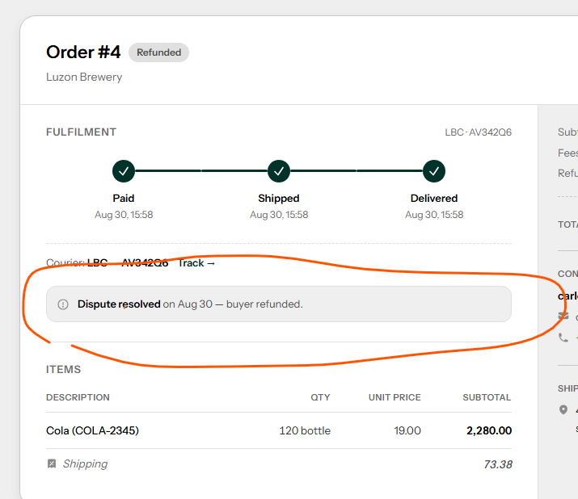

  **Proposed plan:**
  - **Root cause:** The buyer's `order-detail.blade.php` does not contain any UI elements or links directing the buyer to the dispute resolution details once a dispute has been resolved.
  - **Proposed change:** Add a conditional block in `order-detail.blade.php`: if `$order->disputes->isNotEmpty()`, display a "View Dispute" button or alert banner. Ensure it links to the relevant dispute detail modal or route.
  - **Conventions:** Standard Blade conditional rendering.
  - **Edge cases & risks:** The disputes relationship must be eager-loaded in `OrderDetail.php` to avoid N+1 issues.
  - **Tests:** Add a Feature test verifying that the "View Dispute" button is visible to the buyer on orders with a dispute, and hidden otherwise.

- [ ] **#47 — Make Escalated more prominent**
  **Issue:** In the admin dispute queue, the "Escalated" status needs to be more visually prominent so admins can quickly prioritize them.

  **Files to investigate:**
  - `resources/views/livewire/admin/disputes/dispute-queue.blade.php` - The table row or status badge for escalated disputes.

  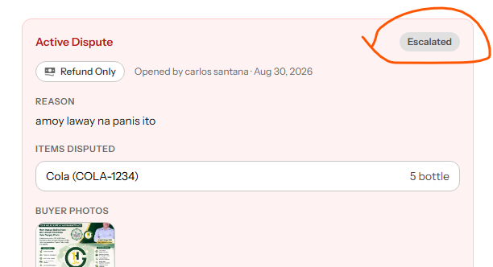

  **Proposed plan:**
  - **Root cause:** The status badge for `escalated` disputes in the admin queue uses standard, low-contrast styling that makes it hard to distinguish from normal pending disputes.
  - **Proposed change:** Update `resources/views/components/hs-status-pill.blade.php` (or the local status rendering logic) to apply a high-contrast danger/warning color and optionally an alert icon specifically for the `escalated` status.
  - **Conventions:** Follows Flux UI or existing Tailwind color conventions for priority states.
  - **Edge cases & risks:** None. Purely a cosmetic change.
  - **Tests:** No backend tests needed; verify visually.

- [ ] **#48 — Admin can't navigate to disputed order**
  **Issue:** On the dispute details page in the admin panel, there is no direct link to view the associated order details for better context.

  **Files to investigate:**
  - `resources/views/livewire/admin/disputes/dispute-arbitration.blade.php` - Add a link to the order.

  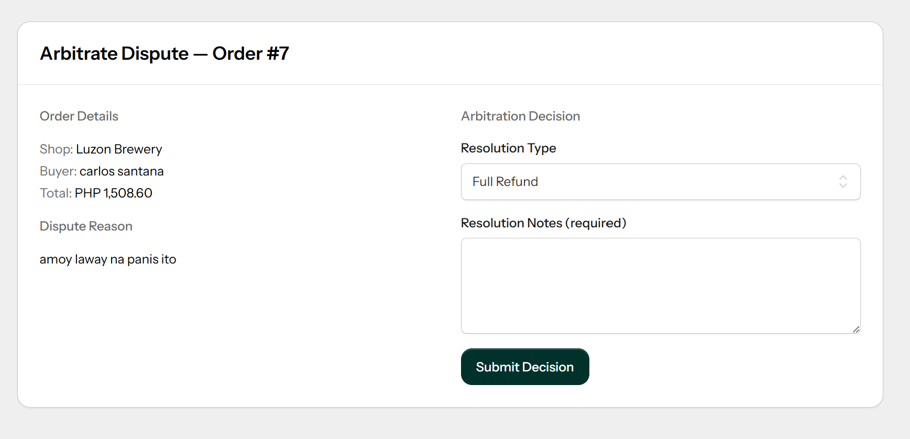

  **Proposed plan:**
  - **Root cause:** The `dispute-arbitration.blade.php` admin view does not include a hyperlink or action button to jump directly into the full order context.
  - **Proposed change:** Add an "View Order" button in the dispute arbitration view header or sidebar, linking to the admin order details route (or the relevant read-only view).
  - **Conventions:** Standard navigation linking.
  - **Edge cases & risks:** Ensure the route actually exists and the admin has permission to view the order.
  - **Tests:** Add a basic test asserting the link is rendered on the page and points to the correct order ID.

## Admin

- [ ] **#49 — Admin can't view payout accounts in full details**
  **Issue:** There is no link on the payout accounts list for admins to open and view the full details of a specific payout account.

  **Files to investigate:**
  - `resources/views/livewire/admin/payout-accounts/payout-account-queue.blade.php` - Add an action link to view the payout account.
  - Route/controller for payout account details (if missing).

  **Proposed plan:**
  - **Root cause:** The admin `payout-account-queue.blade.php` list view does not provide an action link to open a payout account's full details.
  - **Proposed change:** Add a "View" action button/link to the table rows in `payout-account-queue.blade.php`. If an admin payout account detail view/route does not exist, create a basic read-only Livewire component (`PayoutAccountDetail`) and register the route in `routes/web.php`.
  - **Conventions:** Follows the existing admin queue-to-detail navigation pattern.
  - **Edge cases & risks:** Ensure sensitive banking details are appropriately masked if required by compliance rules, even for admins.
  - **Tests:** Add a Feature test verifying the admin can access the detail route and view the payout account data.

## Buyer Profile & Display

- [ ] **#33 — Use buyer's full name instead**
  **Issue:** The buyer profile UI currently displays the user's username or an obscure identifier instead of their full name.

  **Files to investigate:**
  - `resources/views/livewire/account/buyer-profile-form.blade.php` (or wherever this section of the UI is).
  - The model/accessor for the user's full name.

  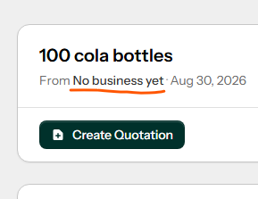

  **Proposed plan:**
  - **Root cause:** `buyer-profile-form.blade.php` (or the layout wrapper) renders the user's username or database identifier instead of their human-readable full name.
  - **Proposed change:** Update the Blade template to output `$user->name` (or `$user->first_name . ' ' . $user->last_name` depending on the User model structure) instead of the generic username.
  - **Conventions:** Standard Eloquent property access.
  - **Edge cases & risks:** If the user hasn't completed their profile, the name might be null. Add a fallback (e.g., `'New Buyer'`) if necessary.
  - **Tests:** Add a basic render test asserting the correct full name appears on the page.
