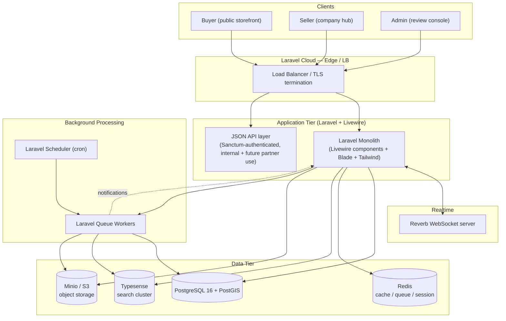
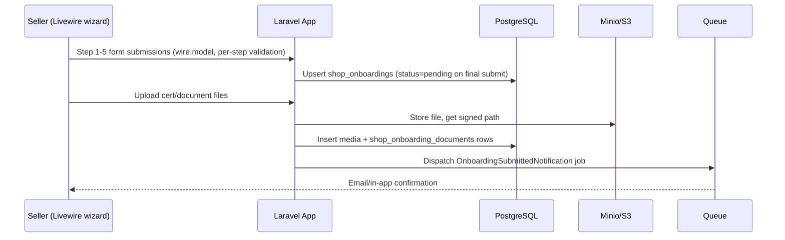
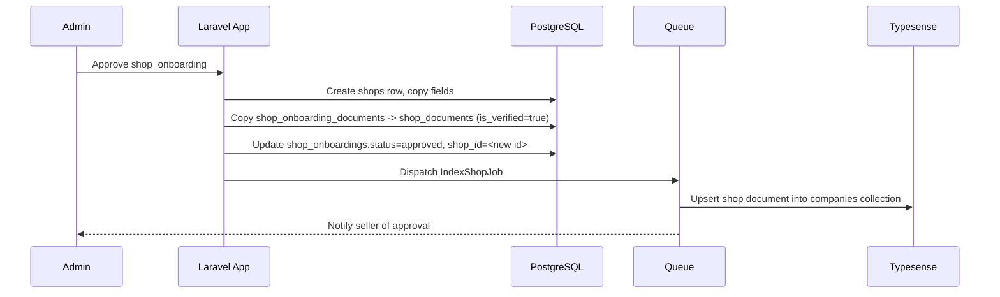
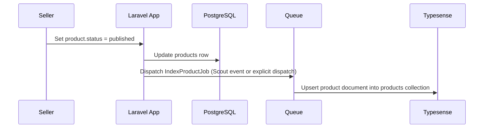

# design.md
## Technical Design Document — Phase 1: Halal Business Directory

| | |
|---|---|
| **Companion doc** | `Phase-1-Halal-B2B-Directory-PRD.md` |
| **Author role** | Lead Systems Architect / Principal UI Engineer |
| **Stack** | PHP/Laravel · Livewire · Tailwind · Redis · PostgreSQL · Reverb · Typesense · DLT Payments (dormant) · Minio/S3 · Laravel Cloud |
| **Status** | Draft for engineering review |

---

## 1. System Architecture Overview

### 1.1 High-level architecture



### 1.2 Component interactions & data flow

**Onboarding write path**


**Admin approval → publish path**


**Product publish → search index path**


### 1.3 Deployment topology (Laravel Cloud)
- **App environment**: Laravel Cloud-managed web + worker processes (autoscaled), single Laravel codebase serving both server-rendered Livewire UI and the JSON API.
- **Database**: Laravel Cloud-managed PostgreSQL with the `postgis` extension enabled for geospatial columns/queries.
- **Cache/Queue/Session**: Laravel Cloud-managed Redis instance (separate logical DBs/prefixes for cache vs. queue vs. session to avoid key collisions).
- **Search**: Typesense Cloud (or self-hosted cluster) reachable over private network from app + workers.
- **Object storage**: Minio (self-hosted, S3-compatible) or AWS S3, addressed via Laravel's `s3` filesystem driver; all `media` uploads go through pre-signed URLs where practical to avoid proxying large files through the app server.
- **Realtime**: Reverb runs as its own long-lived process (managed via Laravel Cloud's worker process type), fronted by the LB with WebSocket upgrade support.

---

## 2. Database Schema & Data Model

Target: **PostgreSQL 16+**, with the **PostGIS** extension enabled for the geospatial requirement noted in the PRD (address → lat/long, future "near me" search).

```sql
CREATE EXTENSION IF NOT EXISTS postgis;
CREATE EXTENSION IF NOT EXISTS pgcrypto; -- for gen_random_uuid() if UUID PKs are preferred
```

### 2.1 Conventions
- Primary keys: `BIGINT GENERATED ALWAYS AS IDENTITY` (Laravel default `id()`), except `media` which may use UUID for safer external referencing — decision left to implementation, shown here as BIGINT for consistency.
- All tables include `created_at` / `updated_at` (`timestamp(0) without time zone`), managed by Eloquent.
- Soft deletes (`deleted_at`) are added to `shops` and `products` to preserve directory history without hard deletion.
- Money fields use `NUMERIC(12,2)`, never `FLOAT`.

### 2.2 Core tables

```sql
-- ========================= USERS =========================
CREATE TABLE users (
    id                BIGINT GENERATED ALWAYS AS IDENTITY PRIMARY KEY,
    first_name        VARCHAR(100) NOT NULL,
    last_name         VARCHAR(100) NOT NULL,
    email             VARCHAR(255) NOT NULL UNIQUE,
    password          VARCHAR(255) NOT NULL,
    phone             VARCHAR(30),
    photo_path        VARCHAR(255),
    email_verified_at TIMESTAMP(0),
    remember_token    VARCHAR(100),
    created_at        TIMESTAMP(0) NOT NULL DEFAULT now(),
    updated_at        TIMESTAMP(0) NOT NULL DEFAULT now()
);

-- ================== ROLES & PERMISSIONS ==================
-- (spatie/laravel-permission convention — pivot-based RBAC)
CREATE TABLE roles (
    id    BIGINT GENERATED ALWAYS AS IDENTITY PRIMARY KEY,
    name  VARCHAR(50) NOT NULL UNIQUE,       -- 'admin', 'seller', 'buyer'
    guard_name VARCHAR(50) NOT NULL DEFAULT 'web'
);

CREATE TABLE permissions (
    id    BIGINT GENERATED ALWAYS AS IDENTITY PRIMARY KEY,
    name  VARCHAR(100) NOT NULL UNIQUE,      -- 'onboarding.review', 'category.manage', ...
    guard_name VARCHAR(50) NOT NULL DEFAULT 'web'
);

CREATE TABLE role_has_permissions (
    permission_id BIGINT NOT NULL REFERENCES permissions(id) ON DELETE CASCADE,
    role_id       BIGINT NOT NULL REFERENCES roles(id) ON DELETE CASCADE,
    PRIMARY KEY (permission_id, role_id)
);

CREATE TABLE model_has_roles (
    role_id    BIGINT NOT NULL REFERENCES roles(id) ON DELETE CASCADE,
    model_type VARCHAR(255) NOT NULL,
    model_id   BIGINT NOT NULL,
    PRIMARY KEY (role_id, model_id, model_type)
);
CREATE INDEX idx_model_has_roles_model ON model_has_roles(model_id, model_type);

-- ========================= CATEGORIES =========================
CREATE TABLE categories (
    id          BIGINT GENERATED ALWAYS AS IDENTITY PRIMARY KEY,
    name        VARCHAR(150) NOT NULL,
    description TEXT,
    slug        VARCHAR(170) NOT NULL UNIQUE,
    created_at  TIMESTAMP(0) NOT NULL DEFAULT now(),
    updated_at  TIMESTAMP(0) NOT NULL DEFAULT now()
);
CREATE INDEX idx_categories_slug ON categories(slug);

-- ========================= MEDIA =========================
CREATE TABLE media (
    id              BIGINT GENERATED ALWAYS AS IDENTITY PRIMARY KEY,
    original_filename VARCHAR(255) NOT NULL,
    extension       VARCHAR(20) NOT NULL,
    storage_path    VARCHAR(500) NOT NULL,   -- S3/Minio object key
    mime_type       VARCHAR(150) NOT NULL,
    description     VARCHAR(255),            -- e.g. 'business permit', 'halal certificate'
    uploaded_by_id  BIGINT NOT NULL REFERENCES users(id) ON DELETE RESTRICT,
    created_at      TIMESTAMP(0) NOT NULL DEFAULT now(),
    updated_at      TIMESTAMP(0) NOT NULL DEFAULT now()
);
CREATE INDEX idx_media_uploaded_by ON media(uploaded_by_id);

-- ========================= SHOP ONBOARDINGS =========================
CREATE TYPE onboarding_status AS ENUM ('pending','requires_revision','approved','rejected');
CREATE TYPE business_structure AS ENUM ('sole_proprietorship','partnership','corporation');
CREATE TYPE export_readiness AS ENUM ('never_exported','exporting_regionally','exporting_globally');

CREATE TABLE shop_onboardings (
    id                              BIGINT GENERATED ALWAYS AS IDENTITY PRIMARY KEY,
    user_id                         BIGINT NOT NULL REFERENCES users(id) ON DELETE CASCADE,
    registered_business_name        VARCHAR(255) NOT NULL,
    storefront_name                 VARCHAR(255) NOT NULL,
    business_structure              business_structure NOT NULL,
    dti_sec_number                  VARCHAR(100) NOT NULL,
    tax_identification_number       VARCHAR(50)  NOT NULL,
    phone                           VARCHAR(30),
    email                           VARCHAR(255),
    address_1                       VARCHAR(255),
    address_2                       VARCHAR(255),
    city                            VARCHAR(120),
    province                        VARCHAR(120),
    zip_code                        VARCHAR(20),
    country_code                    CHAR(2) NOT NULL DEFAULT 'PH',
    geo_location                    GEOGRAPHY(POINT, 4326),  -- PostGIS: lng/lat
    product_categories              VARCHAR(500),            -- CSV snapshot of category names
    fda_lto_number                  VARCHAR(100),
    average_production_lead_time    SMALLINT,                -- days
    export_readiness_status         export_readiness NOT NULL DEFAULT 'never_exported',
    value_chain_positions           JSONB NOT NULL DEFAULT '[]', -- ["processing","manufacturing"]
    capabilities                    JSONB NOT NULL DEFAULT '[]', -- ["packaging","contract_manufacturing",...]
    status                          onboarding_status NOT NULL DEFAULT 'pending',
    shop_id                         BIGINT REFERENCES shops(id) ON DELETE SET NULL,
    admin_notes                     TEXT,
    submitted_at                    TIMESTAMP(0),
    reviewed_at                     TIMESTAMP(0),
    reviewed_by_id                  BIGINT REFERENCES users(id) ON DELETE SET NULL,
    created_at                      TIMESTAMP(0) NOT NULL DEFAULT now(),
    updated_at                      TIMESTAMP(0) NOT NULL DEFAULT now()
);
CREATE INDEX idx_onboardings_user ON shop_onboardings(user_id);
CREATE INDEX idx_onboardings_status ON shop_onboardings(status);
CREATE INDEX idx_onboardings_geo ON shop_onboardings USING GIST (geo_location);

-- Child table resolving the "multiple certificates per onboarding" open question from the PRD
CREATE TYPE halal_cert_body AS ENUM ('IDCP','HDIP','PRIME_CERTIFICATION','OTHER_NCMF');

CREATE TABLE shop_onboarding_certificates (
    id                          BIGINT GENERATED ALWAYS AS IDENTITY PRIMARY KEY,
    onboarding_id               BIGINT NOT NULL REFERENCES shop_onboardings(id) ON DELETE CASCADE,
    certification_body          halal_cert_body NOT NULL,
    certification_body_other    VARCHAR(150),   -- populated when body = OTHER_NCMF
    registration_number         VARCHAR(100) NOT NULL,
    expiry_date                 DATE NOT NULL,
    media_id                    BIGINT NOT NULL REFERENCES media(id) ON DELETE RESTRICT,
    created_at                  TIMESTAMP(0) NOT NULL DEFAULT now(),
    updated_at                  TIMESTAMP(0) NOT NULL DEFAULT now()
);
CREATE INDEX idx_onboarding_certs_onboarding ON shop_onboarding_certificates(onboarding_id);
CREATE INDEX idx_onboarding_certs_expiry ON shop_onboarding_certificates(expiry_date);

CREATE TABLE shop_onboarding_documents (
    onboarding_id BIGINT NOT NULL REFERENCES shop_onboardings(id) ON DELETE CASCADE,
    media_id      BIGINT NOT NULL REFERENCES media(id) ON DELETE RESTRICT,
    PRIMARY KEY (onboarding_id, media_id)
);

-- ========================= SHOPS (live directory) =========================
CREATE TYPE shop_status AS ENUM ('active','inactive','suspended');

CREATE TABLE shops (
    id                              BIGINT GENERATED ALWAYS AS IDENTITY PRIMARY KEY,
    registered_business_name        VARCHAR(255) NOT NULL,
    storefront_name                 VARCHAR(255) NOT NULL,
    business_structure              business_structure NOT NULL,
    dti_sec_number                  VARCHAR(100) NOT NULL,
    tax_identification_number       VARCHAR(50) NOT NULL,
    phone                           VARCHAR(30),
    email                           VARCHAR(255),
    address_1                       VARCHAR(255),
    address_2                       VARCHAR(255),
    city                            VARCHAR(120),
    province                        VARCHAR(120),
    zip_code                        VARCHAR(20),
    country_code                    CHAR(2) NOT NULL DEFAULT 'PH',
    geo_location                    GEOGRAPHY(POINT, 4326),
    fda_lto_number                  VARCHAR(100),
    average_production_lead_time    SMALLINT,
    export_readiness_status         export_readiness NOT NULL DEFAULT 'never_exported',
    value_chain_positions           JSONB NOT NULL DEFAULT '[]',
    capabilities                    JSONB NOT NULL DEFAULT '[]',
    user_id                         BIGINT NOT NULL UNIQUE REFERENCES users(id) ON DELETE RESTRICT, -- 1 shop per user (Phase 1)
    status                          shop_status NOT NULL DEFAULT 'active',
    deleted_at                      TIMESTAMP(0),
    created_at                      TIMESTAMP(0) NOT NULL DEFAULT now(),
    updated_at                      TIMESTAMP(0) NOT NULL DEFAULT now()
);
CREATE INDEX idx_shops_status ON shops(status) WHERE deleted_at IS NULL;
CREATE INDEX idx_shops_geo ON shops USING GIST (geo_location);

CREATE TYPE shop_cert_status AS ENUM ('active','expiring_soon','expired');

CREATE TABLE shop_certificates (
    id                          BIGINT GENERATED ALWAYS AS IDENTITY PRIMARY KEY,
    shop_id                     BIGINT NOT NULL REFERENCES shops(id) ON DELETE CASCADE,
    certification_body          halal_cert_body NOT NULL,
    certification_body_other    VARCHAR(150),
    registration_number         VARCHAR(100) NOT NULL,
    expiry_date                 DATE NOT NULL,
    status                      shop_cert_status NOT NULL DEFAULT 'active',
    media_id                    BIGINT NOT NULL REFERENCES media(id) ON DELETE RESTRICT,
    is_verified                 BOOLEAN NOT NULL DEFAULT TRUE, -- false if uploaded post-approval, pending re-review
    created_at                  TIMESTAMP(0) NOT NULL DEFAULT now(),
    updated_at                  TIMESTAMP(0) NOT NULL DEFAULT now()
);
CREATE INDEX idx_shop_certs_shop ON shop_certificates(shop_id);
CREATE INDEX idx_shop_certs_expiry ON shop_certificates(expiry_date) WHERE status <> 'expired';

CREATE TABLE shop_categories (
    shop_id     BIGINT NOT NULL REFERENCES shops(id) ON DELETE CASCADE,
    category_id BIGINT NOT NULL REFERENCES categories(id) ON DELETE CASCADE,
    PRIMARY KEY (shop_id, category_id)
);

CREATE TABLE shop_documents (
    shop_id     BIGINT NOT NULL REFERENCES shops(id) ON DELETE CASCADE,
    media_id    BIGINT NOT NULL REFERENCES media(id) ON DELETE RESTRICT,
    is_verified BOOLEAN NOT NULL DEFAULT FALSE,
    PRIMARY KEY (shop_id, media_id)
);

-- ========================= PRODUCTS =========================
CREATE TYPE listing_status AS ENUM ('published','archived');

CREATE TABLE products (
    id                  BIGINT GENERATED ALWAYS AS IDENTITY PRIMARY KEY,
    shop_id             BIGINT NOT NULL REFERENCES shops(id) ON DELETE CASCADE,
    name                VARCHAR(255) NOT NULL,
    description         TEXT,
    featured_image_path VARCHAR(500),
    status              listing_status NOT NULL DEFAULT 'archived',
    deleted_at          TIMESTAMP(0),
    created_at          TIMESTAMP(0) NOT NULL DEFAULT now(),
    updated_at          TIMESTAMP(0) NOT NULL DEFAULT now()
);
CREATE INDEX idx_products_shop ON products(shop_id);
CREATE INDEX idx_products_status ON products(status) WHERE deleted_at IS NULL;

CREATE TABLE product_categories (
    product_id  BIGINT NOT NULL REFERENCES products(id) ON DELETE CASCADE,
    category_id BIGINT NOT NULL REFERENCES categories(id) ON DELETE CASCADE,
    PRIMARY KEY (product_id, category_id)
);

CREATE TABLE product_variants (
    id                      BIGINT GENERATED ALWAYS AS IDENTITY PRIMARY KEY,
    product_id              BIGINT NOT NULL REFERENCES products(id) ON DELETE CASCADE,
    sku                     VARCHAR(100) NOT NULL,
    description             VARCHAR(500),
    attributes              JSONB NOT NULL DEFAULT '{}',  -- {"size":"1kg","color":"n/a"}
    price                   NUMERIC(12,2) NOT NULL,
    currency                CHAR(3) NOT NULL DEFAULT 'PHP',
    minimum_order_quantity  INTEGER NOT NULL DEFAULT 1,
    quantity_breaks         JSONB NOT NULL DEFAULT '[]',  -- [{"min_qty":100,"price":9.5}, ...]
    unit                    VARCHAR(30) NOT NULL,         -- kg, box, pallet...
    available_quantity      INTEGER,
    lead_time_days          SMALLINT,
    pack_size               VARCHAR(100),
    status                  listing_status NOT NULL DEFAULT 'archived',
    created_at              TIMESTAMP(0) NOT NULL DEFAULT now(),
    updated_at              TIMESTAMP(0) NOT NULL DEFAULT now(),
    UNIQUE (product_id, sku)
);
CREATE INDEX idx_variants_product ON product_variants(product_id);
CREATE INDEX idx_variants_status ON product_variants(status);

CREATE TABLE product_documents (
    product_id BIGINT NOT NULL REFERENCES products(id) ON DELETE CASCADE,
    media_id   BIGINT NOT NULL REFERENCES media(id) ON DELETE RESTRICT,
    PRIMARY KEY (product_id, media_id)
);

CREATE TABLE product_gallery (
    id         BIGINT GENERATED ALWAYS AS IDENTITY PRIMARY KEY,
    product_id BIGINT NOT NULL REFERENCES products(id) ON DELETE CASCADE,
    media_id   BIGINT NOT NULL REFERENCES media(id) ON DELETE RESTRICT,
    sort_order SMALLINT NOT NULL DEFAULT 0
);
CREATE INDEX idx_gallery_product ON product_gallery(product_id, sort_order);
```

### 2.3 Relationship summary

| Relationship | Cardinality |
|---|---|
| `users` → `shop_onboardings` | 1:1 (Phase 1 constraint) |
| `users` → `shops` | 1:1 (`shops.user_id UNIQUE`) |
| `shop_onboardings` → `shop_onboarding_certificates` | 1:N |
| `shop_onboardings` → `shop_onboarding_documents` → `media` | N:M via join table |
| `shops` → `shop_certificates` | 1:N |
| `shops` ↔ `categories` | N:M via `shop_categories` |
| `shops` → `shop_documents` → `media` | N:M via join table |
| `shops` → `products` | 1:N |
| `products` ↔ `categories` | N:M via `product_categories` |
| `products` → `product_variants` | 1:N |
| `products` → `product_documents` → `media` | N:M via join table |
| `products` → `product_gallery` → `media` | 1:N ordered gallery (join with `sort_order`) |
| `roles` ↔ `permissions` | N:M via `role_has_permissions` |
| `users` ↔ `roles` | N:M via `model_has_roles` (polymorphic, supports future actor types) |

### 2.4 Notes on schema decisions (resolving PRD open questions)
- **Multi-certificate support**: resolved via `shop_onboarding_certificates` / `shop_certificates` child tables rather than flat columns on `shop_onboardings`/`shops`.
- **Product categories**: resolved via an explicit `product_categories` join table (independent of `shop_categories`), so a product can be tagged more granularly than its parent shop's primary categories.
- **Variant fields**: `product_variants` includes `quantity_breaks`, `available_quantity`, `lead_time_days`, `pack_size`, and `status` per the Phase-1 feature brief.
- **Certificate expiry state machine**: `shop_certificates.status` (`active` → `expiring_soon` → `expired`) is maintained by the scheduled job in §5.1, rather than computed ad hoc on every read, so the storefront/admin queries stay index-friendly.

---

## 3. API Contracts & Interface Specs

Phase 1's primary UI is server-rendered via Livewire (no SPA required), but a **versioned JSON API** (`/api/v1/*`) is still specified for: mobile clients, partner integrations, and to decouple the storefront's search/read paths for caching. Auth via **Laravel Sanctum** (session cookies for first-party Livewire/browser clients, personal access tokens for external API consumers).

### 3.1 Conventions
- Base path: `/api/v1`
- Auth header (external clients): `Authorization: Bearer <token>`
- Content type: `application/json`
- Pagination: cursor-based on list endpoints — `?cursor=<opaque>&limit=20`
- Standard error envelope:
```json
{
  "error": {
    "code": "VALIDATION_ERROR",
    "message": "The registered business name field is required.",
    "fields": {
      "registered_business_name": ["The registered business name field is required."]
    }
  }
}
```
- Standard error codes: `VALIDATION_ERROR` (422), `UNAUTHENTICATED` (401), `FORBIDDEN` (403), `NOT_FOUND` (404), `CONFLICT` (409), `RATE_LIMITED` (429), `SERVER_ERROR` (500).

### 3.2 Auth & account

| Method | Endpoint | Purpose |
|---|---|---|
| POST | `/api/v1/register` | Create user account |
| POST | `/api/v1/login` | Session/token login |
| POST | `/api/v1/logout` | Revoke session/token |
| POST | `/api/v1/email/verify/{id}/{hash}` | Email verification callback |
| POST | `/api/v1/email/resend` | Resend verification email |

**POST `/api/v1/register`**
```json
// Request
{
  "first_name": "Amina",
  "last_name": "Reyes",
  "email": "amina@example.com",
  "password": "•••••••••",
  "password_confirmation": "•••••••••"
}
// Response 201
{
  "data": {
    "id": 42,
    "email": "amina@example.com",
    "email_verified_at": null
  }
}
```

### 3.3 Company onboarding (Company Hub)

| Method | Endpoint | Purpose |
|---|---|---|
| GET | `/api/v1/onboarding` | Get current user's in-progress/submitted onboarding |
| PUT | `/api/v1/onboarding/step/{n}` | Upsert a given wizard step (n = 1..5), partial save |
| POST | `/api/v1/onboarding/certificates` | Add a halal certificate entry |
| DELETE | `/api/v1/onboarding/certificates/{id}` | Remove a certificate entry (pre-submission only) |
| POST | `/api/v1/onboarding/documents` | Upload a checklist document (multipart) |
| POST | `/api/v1/onboarding/submit` | Finalize submission → status `pending` |

**PUT `/api/v1/onboarding/step/3`** (Halal integrity & certification data step)
```json
// Request
{
  "certificates": [
    {
      "certification_body": "IDCP",
      "registration_number": "IDCP-2026-00931",
      "expiry_date": "2027-03-15",
      "media_id": 8831
    }
  ]
}
// Response 200
{
  "data": {
    "onboarding_id": 501,
    "step": 3,
    "status": "pending",
    "certificates": [
      { "id": 9, "certification_body": "IDCP", "expiry_date": "2027-03-15" }
    ]
  }
}
```

**POST `/api/v1/onboarding/documents`** (multipart/form-data)
```
file: <binary>
description: "business permit"
```
```json
// Response 201
{
  "data": { "media_id": 8831, "original_filename": "permit_2026.pdf", "storage_path": "media/8831/permit_2026.pdf" }
}
```

**POST `/api/v1/onboarding/submit`**
```json
// Response 200
{ "data": { "onboarding_id": 501, "status": "pending", "submitted_at": "2026-08-14T09:12:00Z" } }
// Response 422 (incomplete steps)
{
  "error": {
    "code": "VALIDATION_ERROR",
    "message": "Onboarding is incomplete.",
    "fields": { "step_3": ["At least one halal certificate is required."] }
  }
}
```

### 3.4 Admin review console

| Method | Endpoint | Purpose |
|---|---|---|
| GET | `/api/v1/admin/onboardings?status=pending` | Queue listing (RBAC: `onboarding.review`) |
| GET | `/api/v1/admin/onboardings/{id}` | Full onboarding detail incl. documents/certs |
| POST | `/api/v1/admin/onboardings/{id}/approve` | Approve → provisions `shops` |
| POST | `/api/v1/admin/onboardings/{id}/request-revision` | Requires `notes` |
| POST | `/api/v1/admin/onboardings/{id}/reject` | Requires `notes` |
| GET/POST | `/api/v1/admin/categories` | List/create categories (`category.manage`) |
| PUT/DELETE | `/api/v1/admin/categories/{id}` | Update/delete category |

**POST `/api/v1/admin/onboardings/501/approve`**
```json
// Response 200
{
  "data": {
    "onboarding_id": 501,
    "status": "approved",
    "shop_id": 233,
    "reviewed_at": "2026-08-14T10:00:00Z",
    "reviewed_by_id": 3
  }
}
```

**POST `/api/v1/admin/onboardings/501/request-revision`**
```json
// Request
{ "notes": "TIN does not match uploaded BIR Form 2303. Please re-upload a clear scan." }
// Response 200
{ "data": { "onboarding_id": 501, "status": "requires_revision" } }
```

### 3.5 Products (Company Hub)

| Method | Endpoint | Purpose |
|---|---|---|
| GET | `/api/v1/hub/products` | List own shop's products |
| POST | `/api/v1/hub/products` | Create product (draft/archived) |
| PUT | `/api/v1/hub/products/{id}` | Update product |
| POST | `/api/v1/hub/products/{id}/publish` | Set status → published (requires ≥1 published variant) |
| POST | `/api/v1/hub/products/{id}/variants` | Add variant |
| PUT | `/api/v1/hub/products/{id}/variants/{variantId}` | Update variant |
| POST | `/api/v1/hub/products/{id}/gallery` | Upload gallery image (multipart, sets sort_order) |
| POST | `/api/v1/hub/products/{id}/documents` | Attach spec/manual/warranty doc |

**POST `/api/v1/hub/products`**
```json
// Request
{
  "name": "Halal-Certified Coconut Flour",
  "description": "Fine-milled, allergen-controlled coconut flour for bakery applications.",
  "category_ids": [14, 22]
}
// Response 201
{ "data": { "id": 9012, "status": "archived", "shop_id": 233 } }
```

**POST `/api/v1/hub/products/9012/variants`**
```json
// Request
{
  "sku": "CF-1KG",
  "attributes": { "pack_size": "1kg", "grade": "Food Grade A" },
  "price": 185.00,
  "currency": "PHP",
  "minimum_order_quantity": 50,
  "quantity_breaks": [{ "min_qty": 500, "price": 172.50 }],
  "unit": "bag",
  "available_quantity": 12000,
  "lead_time_days": 10,
  "pack_size": "1kg pouch, 20 per carton"
}
// Response 201
{ "data": { "id": 55231, "product_id": 9012, "sku": "CF-1KG", "status": "archived" } }
```

### 3.6 Public discovery (Storefront)

| Method | Endpoint | Purpose |
|---|---|---|
| GET | `/api/v1/search/companies?q=&category=&province=&lat=&lng=&radius_km=` | NLS + filtered company search (Typesense-backed) |
| GET | `/api/v1/search/products?q=&category=&shop_id=` | NLS + filtered product search |
| GET | `/api/v1/companies/{slug}` | Public company profile |
| GET | `/api/v1/products/{id}` | Public product detail (variants, gallery, docs) |
| GET | `/api/v1/categories` | Public category tree/list |

**GET `/api/v1/search/products?q=coconut+flour&category=bakery-ingredients`**
```json
// Response 200
{
  "data": [
    {
      "id": 9012,
      "name": "Halal-Certified Coconut Flour",
      "shop": { "id": 233, "storefront_name": "Maslaha Foods Co.", "verified": true },
      "price_from": 172.50,
      "currency": "PHP",
      "unit": "bag",
      "minimum_order_quantity": 50,
      "featured_image_url": "https://cdn.../coconut-flour.jpg"
    }
  ],
  "meta": { "found": 1, "search_time_ms": 8, "next_cursor": null }
}
```

### 3.7 Error handling policy
- All validation failures return **422** with a `fields` map (Laravel `FormRequest` → API Resource exception mapping).
- Authorization failures (RBAC/ownership) return **403** with `FORBIDDEN`, never leak whether the resource exists for cross-tenant IDs — use **404** instead where existence itself is sensitive (e.g., another seller's draft onboarding).
- File upload errors (size/type) return **422** with a dedicated `fields.file` message; virus/malware scan failures (see §5) return **422** with code `UNSAFE_FILE`.
- All admin mutation endpoints (`approve`/`reject`/`request-revision`) are wrapped in a DB transaction; partial failure (e.g., Typesense indexing job dispatch failure) does **not** roll back the approval — indexing is decoupled and retried by the queue, not synchronous with the request.

---

## 4. UI Component Architecture & Design System Mapping

### 4.1 Rendering strategy
- **Server-first**: Livewire components render Blade templates server-side; Tailwind utility classes styled per the `--hs-*` design token set (see PRD §8).
- **Client state**: kept minimal — Alpine.js (bundled with Livewire) handles ephemeral UI state (dropdown open/closed, tab selection, modal visibility). No client-side global store; all durable state lives server-side in the Livewire component's public properties, persisted to PostgreSQL.
- **Realtime**: Reverb + Livewire's `wire:poll`/broadcast listeners push admin-queue updates and onboarding-status changes to open browser tabs without full reloads.

### 4.2 Page/component hierarchy by portal

```
resources/views/livewire/
├── auth/
│   ├── register-form.blade.php
│   ├── login-form.blade.php
│   └── verify-email-notice.blade.php
│
├── company-hub/
│   ├── onboarding-wizard.blade.php          [Stepper]
│   │   ├── step-1-company-profile.blade.php  [Form]
│   │   ├── step-2-operations.blade.php       [Form + Checkbox group]
│   │   ├── step-3-halal-certification.blade.php [Repeatable Form + FileUpload]
│   │   ├── step-4-value-chain.blade.php      [Multi-select chips]
│   │   └── step-5-documents.blade.php        [Checklist + FileUpload]
│   ├── shop-profile-editor.blade.php        [Form] (post-approval edits)
│   ├── product-list.blade.php               [Table + Filters]
│   ├── product-form.blade.php               [Form, Modal for quick-create]
│   ├── variant-manager.blade.php            [Inline-editable Table]
│   ├── gallery-manager.blade.php            [Drag-sort grid]
│   └── document-manager.blade.php           [Table + FileUpload]
│
├── admin/
│   ├── onboarding-queue.blade.php           [Table + Status filter tabs]
│   ├── onboarding-review.blade.php          [Detail view + Approve/Revise/Reject Modal]
│   ├── category-manager.blade.php           [Table + Modal Form]
│   └── document-viewer.blade.php            [Modal — PDF/image preview]
│
└── storefront/
    ├── hero-search.blade.php                [Search Widget: tab toggle + input]
    ├── company-directory.blade.php          [Grid: Company Card]
    ├── company-profile.blade.php            [Profile layout: Value Chain Stepper, Badge, Cert list]
    ├── product-directory.blade.php          [Grid: Product Card + Category sidebar]
    ├── product-detail.blade.php             [Gallery, Variant selector, Price/MOQ table]
    └── category-nav.blade.php               [Nav / sidebar tree]
```

### 4.3 Requirement → component mapping

| Requirement | UI Component(s) | Notes |
|---|---|---|
| 5-step company setup | **Stepper** (`onboarding-wizard`) wrapping 5 **Forms** | Each step Livewire-validated independently (`wire:model.blur` + step-scoped `rules()`); progress persisted after every step (draft save) |
| Multiple halal certificates | Repeatable **Form** block within Step 3, backed by a dynamic array property (`public array $certificates = []`) | Add/remove rows client-side via Alpine, submitted as one payload |
| Document checklist upload | **FileUpload** component (Livewire's `WithFileUploads`), pre-signed direct-to-S3 where file size warrants it | Shows required-vs-uploaded checklist state |
| Admin review queue | **Table** with status-filter tabs (`pending`/`requires_revision`/`approved`/`rejected`) | Row click → `onboarding-review` detail |
| Approve/Reject/Revise actions | **Modal** with reason **Form** (required `notes` for revise/reject) | Confirmation modal before state-changing action |
| Category management | **Table** + **Modal Form** (create/edit) | Slug auto-generated from name, editable |
| Product listing | **Table** (list/manage) + **Form** (create/edit) + **Modal** (quick actions: publish/archive) | |
| Variant management | Inline-editable **Table** (SKU, price, MOQ, quantity breaks, lead time, pack size, status toggle) | Quantity breaks edited via a nested mini-form/modal |
| Product gallery | Drag-sortable image grid (Alpine + Livewire `sort_order` sync) | Photo upload only, per PRD |
| Storefront hero search | **Search Widget** (Find Companies / Find Products tab toggle, category select, text input) | Debounced `wire:model.live.debounce.300ms`, calls Typesense-backed search endpoint |
| Company directory / product directory | **Card grid** (Company Card / Product Card per design system §8 of PRD) | Paginated via cursor; responsive grid collapses per breakpoints (`--hs-bp-md`, etc.) |
| Value chain display | **Value Chain Stepper** pill row | Rendered from `shops.value_chain_positions` JSONB |
| Verification/halal badges | **Badge** components (`badge-verified`, `badge-halal`, `badge-gold`) | Purely presentational, driven by `shops.status` / cert status |

### 4.4 State management approach

| State type | Where it lives | Mechanism |
|---|---|---|
| Durable business data (onboarding drafts, products, variants) | PostgreSQL | Livewire component properties hydrate from/persist to Eloquent models on each interaction; no separate client cache |
| Session/auth state | Redis-backed sessions | Laravel session driver = redis |
| Ephemeral UI state (tabs, modals, hover) | Browser (Alpine.js) | Never synced to server; reset on reload |
| Search results | Server-side, per-request | Livewire component queries Typesense on `updated()` hook of the search term property; results not cached client-side beyond the DOM diff |
| Realtime notifications (e.g., "onboarding approved") | Reverb channel → Livewire `#[On]` listener | Private channel scoped to `user.{id}`; admin queue uses a broadcast channel scoped to the `admin` role |
| Cross-request caching (category list, published-shop counts) | Redis (Laravel cache facade) | Tagged cache, invalidated on category/shop mutation events |

---

## 5. Background Jobs, Integrations, & Security

### 5.1 Scheduled jobs (Laravel Scheduler → Redis queue)

| Job | Schedule | Logic |
|---|---|---|
| `ScanCertificateExpiryJob` | Daily, 02:00 UTC | Query `shop_certificates` where `expiry_date` is within a configurable warning window (e.g., 60/30/7 days) or already past → transition `status` (`active`→`expiring_soon`→`expired`); dispatch `CertificateExpiryNotification` (email + in-app) to the shop owner for each threshold crossed (idempotent — track `last_alert_sent_at` per threshold to avoid duplicate sends) |
| `SyncSearchIndexJob` | Every 5 min (safety net) + event-driven dispatch on publish/approve | Reconciles any `shops`/`products` rows whose `updated_at` is newer than their Typesense document's indexed timestamp |
| `PruneStaleOnboardingDraftsJob` | Weekly | Flags (does not delete) `shop_onboardings` left in `pending` draft state with no activity for N days, notifies the user to resume |
| `ReconcileMediaOrphansJob` | Weekly | Identifies `media` rows with no referencing join-table row (abandoned uploads) and removes the S3 object + row after a grace period |

### 5.2 Event-driven jobs (dispatched inline from controllers/Livewire actions)

| Job | Trigger | Action |
|---|---|---|
| `IndexShopJob` | `shops` created/updated, status change | Upsert/remove Typesense `companies` collection document |
| `IndexProductJob` | `product`/`product_variants` publish/archive | Upsert/remove Typesense `products` collection document |
| `ScanUploadedFileJob` | Any `media` upload | Runs antivirus/malware scan (e.g., ClamAV via queued job) before the file is considered "clean"; blocks certificate/document from being marked verifiable until scan passes |
| `OnboardingSubmittedNotification` | Onboarding `submit` | Emails user + notifies admin queue via Reverb broadcast |
| `OnboardingDecisionNotification` | Approve/revise/reject | Emails + in-app notifies the seller with `admin_notes` if present |

### 5.3 Third-party integrations

| Integration | Purpose | Notes |
|---|---|---|
| **Geocoding API** (e.g., Google Maps Geocoding or Mapbox) | Convert onboarding address → `geo_location` (PostGIS point) | Called synchronously on step-1 save (with graceful degradation — save address even if geocoding fails, retry via queued job) |
| **Typesense** | Search indexing/query | Laravel Scout driver (`typesense` engine) wraps `IndexShopJob`/`IndexProductJob` |
| **Minio/S3** | Object storage | Laravel `Storage::disk('s3')`, pre-signed URLs for upload and (where documents are private) for admin/owner viewing |
| **Mail/notification provider** | Transactional email | Standard Laravel `Mail`/`Notification` channels, queued |
| **DLT Payments** | *Not integrated in Phase 1* | Config/env placeholders reserved; no live code path until Phase 3 |

### 5.4 Authentication & authorization

- **Authentication**: Laravel's built-in auth (session-based for Livewire/browser) + **Sanctum** personal access tokens for API/mobile consumers. Email verification (`email_verified_at`) gates access to onboarding.
- **Authorization model**: **RBAC** via `roles`/`permissions`/pivot tables (spatie/laravel-permission-compatible schema, §2.2). Three baseline roles for Phase 1:

| Role | Key permissions |
|---|---|
| `admin` | `onboarding.review`, `category.manage`, `document.view_any` |
| `seller` | `shop.manage_own`, `product.manage_own` |
| `buyer` | `directory.browse` (implicit/public, no elevated permission needed) |

- **Row-level ownership enforcement** (beyond RBAC roles): Laravel **Policies** on `ShopOnboarding`, `Shop`, `Product`, and `ProductVariant` models enforce that a `seller` may only view/mutate records where `record.user_id === auth()->id()` (or `record.shop->user_id`), independent of role — this is the "row-level security" equivalent, implemented in the application layer (Postgres RLS policies are a viable hardening option for a future phase if direct DB access patterns expand beyond the Laravel app).
- **Admin document access**: `document.view_any` permission gates access to any shop's private uploaded documents (certs, permits, BIR forms) via signed, time-limited S3 URLs — never public paths.
- **File upload security**: strict MIME/extension allow-list, max file size enforced both client- and server-side, `ScanUploadedFileJob` (antivirus) must pass before a document counts toward onboarding-checklist completion.
- **Rate limiting**: `login`, `register`, and `search` endpoints throttled via Laravel's rate limiter (Redis-backed) to mitigate brute force and search-scraping.
- **Audit trail**: `shop_onboardings.reviewed_by_id` + `reviewed_at` + `admin_notes` provide a minimal audit trail for verification decisions; consider a dedicated `audit_logs` table if broader activity logging becomes a requirement.

### 5.5 Use of Laravel Boost in this project

**Laravel Boost** (`laravel/boost`, installed via `composer require laravel/boost --dev` and `php artisan boost:install`) is adopted as the **AI-assisted development tooling layer** for this codebase, not as a production runtime dependency:

- **MCP server for the coding agent**: exposes 15+ tools (application info, database schema/query, Artisan command listing, config lookup, browser log inspection, Tinker execution) so that AI coding agents (Claude Code, Cursor, etc.) working on this repo can introspect the actual running app — real routes, real Eloquent models, the real Postgres schema from §2 — instead of guessing from static analysis alone. This is particularly valuable for a schema this relationally dense (10+ join tables, enums, JSONB columns).
- **Framework-version-correct guidance**: Boost's bundled AI guidelines are scoped to the exact installed versions of Laravel, Livewire, and other Composer packages in this project, reducing the risk of an agent generating code against a wrong Livewire/Laravel API version (a common failure mode given how fast the ecosystem moves).
- **Documentation retrieval**: Boost's semantic-search documentation tool is used by agents when implementing less-common patterns in this spec — e.g., Scout+Typesense driver configuration, Sanctum token scoping, or Reverb private-channel authorization — pulling accurate, version-matched Laravel ecosystem docs instead of relying on training-data recall.
- **Custom guidelines**: project-specific conventions (e.g., "certificate expiry alerts must be idempotent per threshold," "all money fields are `NUMERIC(12,2)`," "never hard-delete `shops`/`products`") are added as `.blade.php` files under `.ai/guidelines/` so they're automatically included alongside Boost's core guidelines for any agent working in this repo.
- **Scope boundary**: Boost is a `--dev` dependency and MCP tooling — it is not exposed to end users, does not run in production, and has no bearing on the runtime architecture described in §1.

---

## 6. Cross-References

- Product scope, portals, user flows, and open schema questions: `Phase-1-Halal-B2B-Directory-PRD.md`
- Design tokens (colors, typography, spacing, component visual spec): PRD §8 / source design-system reference
- Phase 2 (RFQ/Chat/Quote) and Phase 3 (Orders/Payments/Escrow/Dispute) are explicitly out of scope for this document; `products`, `shops`, and `users` are the stable foundation those phases will extend (e.g., an `rfqs` table referencing `product_variants` and `shops` in Phase 2).