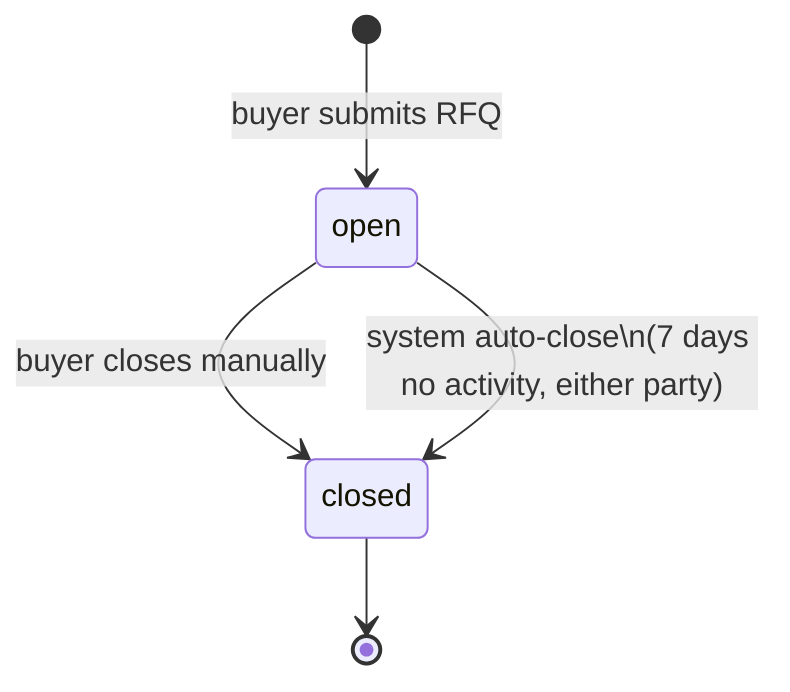
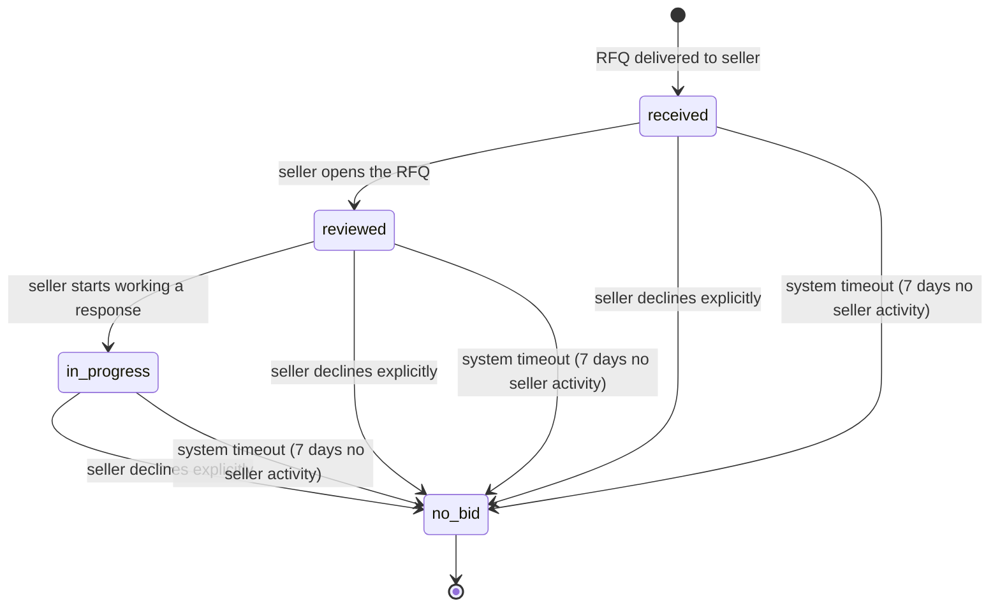
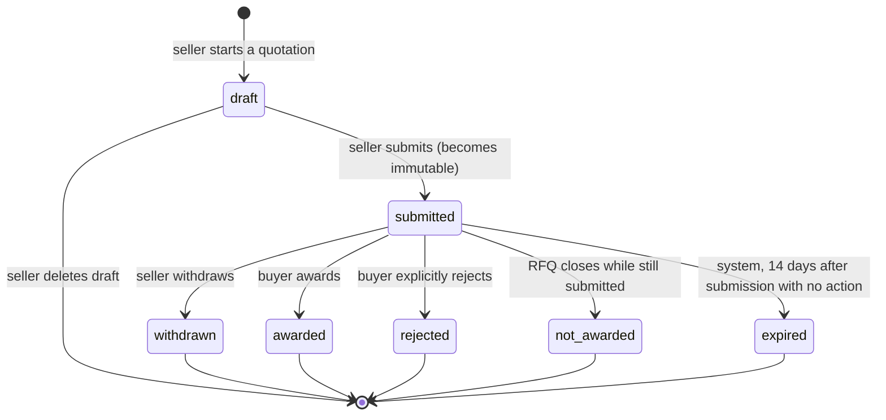

# Product Requirements Document
## Phase 2 — Negotiation (RFQ, Quotation, Chat)

| | |
|---|---|
| **Companion docs** | `Phase-1-Halal-B2B-Directory-PRD.md`, `design.md` (Phase 1), `tasks.md` (Phase 1) |
| **Phase** | 2 of 3 — Negotiation |
| **Doc status** | Draft for review |
| **Owner** | Product / Engineering |

---

## 1. Overview

### 1.1 Product context
Phase 1 delivered **discovery**: a verified directory of halal companies and products. Phase 2 adds the **negotiation layer** on top of it — the mechanism by which a buyer who has found a product turns interest into a priced, comparable offer from a specific seller, with a running conversation alongside it. Phase 3 (Orders & Payments) will consume an **awarded quotation** as its starting input.

> *Can two businesses discover each other, negotiate, place an order, pay securely, deliver goods, and leave feedback?* — Phase 2 answers the "negotiate" part.

### 1.2 Problem statement
A directory listing alone doesn't let a buyer get a real, comparable price for their actual requirement (quantity, customization, private-label needs, etc.), and there's no structured, auditable channel for a seller to respond with a formal, time-bound offer. Phase 2 gives buyers a lightweight way to describe what they need (an RFQ), gives sellers a structured way to respond (one or more quotations), and gives both sides a persistent conversation to work out the details — with the specific business data (who's buying, billing/shipping details, what was actually offered) preserved as an immutable audit record once a negotiation concludes.

### 1.3 Goals
- Let a logged-in buyer send a **Request for Quotation (RFQ)** to a specific seller, starting from a product page.
- Let a seller **review, respond to, or decline** an RFQ, submitting one or more structured **quotations**.
- Let a buyer **award** (accept) any subset of the quotations they receive under an RFQ, and close the RFQ when they're done.
- Give buyer and seller a **persistent, per-relationship conversation** (Discord-style: one conversation per buyer–seller pair, with topic threads inside it — including RFQs, which appear as attachable cards).
- Preserve a **read-only, snapshotted audit trail** once an RFQ or quotation reaches a terminal state.
- Automatically expire stale RFQs and quotations so nothing lingers indefinitely without buyer/seller action.

### 1.4 Non-goals (out of scope for Phase 2)
- Orders, payments, escrow, fulfilment, disputes (Phase 3)
- RFQ-to-multiple-sellers / auto-matching (explicitly deferred — schema is built to support it later, but Phase 2 UI only ever targets one seller per RFQ)
- Admin moderation of RFQs/chat (no admin workflow in scope; admin's Phase 1 role — company/product verification — is unaffected)
- Multiple saved buyer addresses / address books (Phase 2 ships one billing + one default shipping address per buyer profile; see §11)
- In-app formal contract generation (a quotation is a structured price offer, not a legal contract document)

### 1.5 Success metrics
- RFQ → first-quotation response time (median, by seller)
- RFQ → award rate (% of RFQs that end with ≥1 awarded quotation vs. closed with none)
- % of RFQs auto-closed by the 7-day inactivity timer vs. manually closed by buyer (signal for whether the timeout is well-tuned)
- % of seller RFQ copies flagged `no_bid` by timeout vs. explicit decline (signal for seller responsiveness)
- Messages sent per RFQ (engagement depth of the negotiation)

---

## 2. Users & Portals

| Portal | User | Phase 2 additions |
|---|---|---|
| **Buyer / User Account** | Buyer | Buyer company/address profile; "My RFQs" (sent) list + detail; chat inbox |
| **Company Hub / Dashboard** | Seller | "RFQs Received" queue + detail; quotation builder; chat inbox |
| **Sitefront (Storefront)** | Public / buyer | "Request Quote" action on a product page (login-gated) |
| **Admin** | Internal ops | No new functional role in Phase 2 |

---

## 3. Functional Requirements

1. A logged-in buyer can initiate an RFQ from a product page; the RFQ title is pre-filled with the product name but the RFQ itself is a freeform inquiry, not a structured cart.
2. A buyer must have a **buyer profile** (business name, billing address, shipping address) before submitting an RFQ; if missing, they're prompted to complete it first (lightweight, no verification required, unlike seller onboarding).
3. An RFQ targets exactly **one seller (shop)** in Phase 2, even though the underlying schema supports many recipients for a future RFQ-matching release.
4. A seller sees incoming RFQs in a **Company Hub queue**, can mark them reviewed, work on them, explicitly decline (no bid), or submit one or more quotations.
5. A quotation is a structured, itemized offer (line items, pricing, validity period, optional attachments) tied to one RFQ and one seller.
6. A seller can submit **multiple quotations** under the same RFQ (e.g., different pricing/packaging options for the buyer to compare).
7. A buyer can **award** any number of the quotations they receive (award is non-exclusive — awarding one does not reject or close out the others).
8. A buyer can **close** an RFQ manually at any time, with or without any award.
9. The system auto-closes an RFQ if there has been **no activity from either party for 7 days**.
10. The system flags a seller's response to an RFQ as **no_bid** if the seller has taken no action for 7 days.
11. The system auto-expires a submitted quotation **14 days** after submission if it hasn't been awarded, rejected, or withdrawn.
12. RFQs and quotations become **read-only** once they reach a terminal state, retaining a snapshot of buyer business name, billing address, shipping address, and RFQ/quotation content as of that point in time.
13. Buyer and seller can message each other in a **persistent, per-pair conversation**; RFQs (and other topics) can be opened as threads within that conversation, with the RFQ and its quotations displayed as attached cards.
14. Buyers track sent RFQs from their account portal; sellers track received RFQs from the company hub.
15. Both parties receive **real-time (push) and email** notifications for key state changes.

---

## 4. Detailed Feature Specifications

### 4.1 Buyer company/address profile

A lightweight profile, distinct from seller onboarding — **no admin verification required**.

| Field | Notes |
|---|---|
| Business name | Free text |
| Billing address | address_1, address_2, city, province, zip_code, country_code |
| Shipping address | Same shape; defaults to billing address, editable |
| Contact phone / email | Optional override of account defaults |

- Prompted at first RFQ attempt if not yet completed; can also be edited proactively from the buyer account portal.
- This profile is the **source of truth snapshotted** into every RFQ (at creation) and every quotation (at submission) — see §4.5.

### 4.2 RFQ creation ("Request Quote")

- Entry point: a **"Request Quote"** button on a product page (seller/shop is implicit from the page context — this becomes the RFQ's single recipient).
- The RFQ form is an **inquiry form, not a structured cart**:
  - **Title** — pre-filled with the product name (e.g., *"500 nail polishes and 200 lipsticks"* style — buyer can freely edit), buyer can rewrite it to describe a broader request (multiple items, customization, etc.)
  - **Description / requirements** — freeform text where the buyer describes what they need; the originating product is **not** rigidly tagged as a line item — if the buyer wants to reference multiple products/items, they describe them in this field
  - **Optional attachments** — buyer can attach reference files (spec sheets, artwork, etc.)
- On submit: RFQ is created with status `open`, a snapshot of the buyer's profile is captured (§4.5), and exactly one row is created in the RFQ-recipient join table for the target seller/shop.
- **RFQs are not editable once sent** — treated like a sent email. To change the request, the buyer must close (or let it lapse) and send a new one.

### 4.3 Seller RFQ review & response

- Seller sees incoming RFQs in a **Company Hub → RFQs Received** queue, filterable by their per-recipient status (`received` / `reviewed` / `in_progress` / `no_bid`).
- Opening an RFQ transitions it from `received` → `reviewed` (system-driven, on first view).
- Seller can:
  - Move it to `in_progress` (working on a quotation)
  - Explicitly **decline** (sets status to `no_bid` immediately, with an optional reason)
  - Submit one or more **quotations** (status stays `in_progress`/reflects activity; does not auto-transition on its own separate axis — the RFQ recipient status tracks the seller's engagement, while quotations track actual offers)
- Any seller action (status change, message, quotation submission) resets the **7-day no-bid inactivity clock** for that recipient row.

### 4.4 Quotation

A quotation is a **structured, itemized offer** — distinct from the RFQ's freeform inquiry text.

| Field | Notes |
|---|---|
| Quotation line items | One or more: description, quantity, unit, unit price, subtotal |
| Total amount / currency | Computed from line items |
| Valid until | System default: **submission date + 14 days** (fixed default for Phase 2, not seller-editable) |
| Notes / terms | Freeform |
| Attachments | Optional — formal quote PDF, certificate of analysis, etc. |

- **Draft** quotations are private to the seller (editable, not visible to the buyer, can be freely edited or deleted).
- **Submitting** a quotation makes it visible to the buyer and **immediately immutable** — any change requires creating a new quotation (a revision is a new record, not an edit).
- A submitted quotation also captures its own snapshot of the buyer's profile as of that moment (§4.5), independent of the RFQ's snapshot — time may have passed and the buyer's profile may have changed.
- Quotations are displayed as **cards** inside the RFQ's chat thread (§4.6) as well as in the RFQ detail view.

### 4.5 Snapshotting (audit trail)

Per the stated invariant, both RFQs and quotations must remain self-contained historical records once terminal. Snapshot capture points:

| Entity | Snapshot taken at | Snapshotted fields |
|---|---|---|
| RFQ | Creation | Buyer business name, billing address, shipping address (as of that moment) |
| Quotation | Submission | Buyer business name, billing address, shipping address (as of that moment — may differ from the RFQ's snapshot if time has passed) |

Both entities' own content (title/description for RFQ; line items/pricing/terms for quotation) is naturally immutable once submitted, since neither supports post-submission editing.

### 4.6 Chat (peer-to-peer, threaded)

Modeled on a Discord-style pattern: **one persistent conversation per buyer–seller pair**, containing **topic threads**.

- A **conversation** is created (or reused) the first time a buyer and seller interact (first RFQ, or a direct message) — one conversation per unique buyer–seller pair, reused across all future RFQs between them.
- Within a conversation, **threads** hold the actual messages:
  - A default **general** thread exists for freeform conversation not tied to a specific RFQ.
  - Sending an RFQ automatically opens (or the RFQ can be manually opened into) a **dedicated thread** for that RFQ, where the RFQ itself and each of its quotations render as **attached cards** (showing current status at a glance) alongside regular chat messages.
  - Threads can also be created ad hoc for other topics, not just RFQs.
- Chat requires login (both parties must be authenticated); no anonymous/pre-account messaging.
- Threads don't auto-lock when their linked RFQ closes — conversation history remains visible and referenceable, but the attached RFQ/quotation cards reflect their own terminal, read-only state.

### 4.7 Award & close semantics

- **Award is per-quotation, not RFQ-exclusive.** A buyer can award multiple quotations under the same RFQ (e.g., accepting several free-sample offers from the same seller for comparison). Awarding a quotation does **not** close the RFQ and does **not** affect the status of the RFQ's other quotations.
- **RFQ close is a separate, buyer-driven action** (manual) or **system-driven** (7-day dual-inactivity timeout). There is no "cancelled" status distinct from `closed` — a closed RFQ with zero awards and a closed RFQ with several awards are both simply `closed`; the UI differentiates them by displaying aggregates, e.g.:
  > *"1000 bolts — closed (0 awarded | 3 total quotations)"*
- **On RFQ close** (either trigger): any quotation still in `submitted` status under that RFQ transitions to `not_awarded`. Quotations already `awarded`, `rejected`, `withdrawn`, or `expired` are untouched.
- A buyer may also explicitly **reject** an individual quotation at any time while it's `submitted`, independent of closing the whole RFQ.

---

## 5. State Machines

### 5.1 RFQ (master record — buyer-controlled)



- `open` → `closed` is the only transition; `closed` is terminal (read-only, snapshotted).
- "Activity" for the auto-close timer includes: new message in any thread within the conversation, RFQ recipient status change, or quotation submission/award/rejection/withdrawal.

### 5.2 Seller RFQ copy (per recipient — tracks seller engagement)



- This status tracks the seller's engagement with the RFQ, independent of how many quotations (if any) they've submitted.
- Not affected by the parent RFQ's own `open`/`closed` state — a seller can still be `in_progress` when the buyer closes the RFQ (their in-flight quotation, if any, would then move to `not_awarded` per §4.7).

### 5.3 Quotation



- `draft` is mutable and private to the seller; every other state is terminal and read-only once reached.
- `awarded` is not mutually exclusive with sibling quotations also reaching `awarded` under the same RFQ.

---

## 6. Data Model (conceptual)

Full DDL belongs in a Phase 2 addendum to `design.md`; this section defines the entities and relationships needed to get there.

| Entity | Purpose | Key relationships |
|---|---|---|
| `buyer_profiles` | Buyer's business name + billing/shipping address | 1:1 with `users` |
| `rfqs` | The master RFQ record | belongs to buyer (`users`); has snapshot fields captured at creation |
| `rfq_recipients` | Seller-facing copy of an RFQ (join table, schema-ready for many-to-many even though Phase 2 always creates exactly one row) | belongs to `rfqs`, belongs to `shops`; carries the seller-engagement state machine (§5.2) |
| `rfq_attachments` | Buyer-attached reference files | `rfqs` ↔ `media` (N:M) |
| `quotations` | A seller's structured offer against an RFQ | belongs to `rfqs`, belongs to `rfq_recipients` (i.e., to a specific seller); carries its own snapshot fields captured at submission |
| `quotation_items` | Line items within a quotation | belongs to `quotations` (1:N) |
| `quotation_attachments` | Seller-attached files (formal quote, COA, etc.) | `quotations` ↔ `media` (N:M) |
| `conversations` | One persistent thread-container per buyer–seller pair | unique on (buyer `user_id`, `shop_id`) |
| `conversation_threads` | Topic threads within a conversation (general, or RFQ-linked) | belongs to `conversations`; optionally references one `rfqs` row |
| `messages` | Individual chat messages | belongs to `conversation_threads`; sender is a `users` row |
| `message_cards` | Renders an RFQ or quotation as an attached card within a message/thread | references either an `rfqs` row or a `quotations` row (polymorphic reference) |

### 6.1 Relationship summary

```
users 1───1 buyer_profiles
users 1───N rfqs
rfqs  1───N rfq_recipients ───N:1 shops
rfqs  1───N rfq_attachments ───N:1 media
rfq_recipients 1───N quotations
quotations 1───N quotation_items
quotations 1───N quotation_attachments ───N:1 media
users + shops ───1 conversations (unique pair)
conversations 1───N conversation_threads ───0:1 rfqs (nullable link)
conversation_threads 1───N messages
messages 0:1───message_cards ───polymorphic─→ rfqs | quotations
```

### 6.2 Notes carried over from Phase 1 conventions
- Reuse the existing `media` table/upload pipeline for RFQ and quotation attachments (Phase 1 §5, design.md Epic 3).
- `shops` (seller) already exists from Phase 1 — no changes needed there beyond being the target of `rfq_recipients`.
- `product_id` is deliberately **not** a required foreign key on `rfqs` — the originating product only pre-fills the title text; the RFQ itself doesn't structurally reference a specific `products`/`product_variants` row. (Flagged as an explicit design choice, not an oversight — see §11 if reconsideration is wanted.)

---

## 7. Key User Flows

### 7.1 Happy path
1. Buyer browses storefront (Phase 1), finds a product, clicks **"Request Quote"**.
2. If no buyer profile exists yet, buyer is prompted to complete it (business name + billing/shipping address).
3. RFQ form opens, pre-filled title from the product name; buyer edits/adds requirements, optionally attaches files, submits.
4. RFQ created (`open`), one `rfq_recipients` row created for the seller's shop (`received`), conversation/thread created or reused, RFQ card appears in that thread.
5. Seller opens it in **Company Hub → RFQs Received** (`received` → `reviewed`), starts working on it (`in_progress`).
6. Seller builds a quotation (line items, pricing, validity), submits it → `submitted`, immutable, snapshot captured, card appears in the RFQ's thread.
7. Buyer reviews the quotation (via RFQ detail or the chat thread card), messages back and forth with the seller if needed.
8. Buyer **awards** the quotation → `awarded`.
9. Buyer closes the RFQ (or lets the seller submit further quotations first) → `closed`; any other still-`submitted` quotations under it flip to `not_awarded`.
10. *(Phase 3 picks up from the awarded quotation to initiate an order.)*

### 7.2 Seller declines
1–5 as above, then seller clicks **Decline** → `rfq_recipients.status = no_bid`. No quotation is created. RFQ remains `open` (buyer may still message the seller, or let it auto-close).

### 7.3 Multiple quotations, multiple awards
Seller submits 3 quotations under one RFQ (e.g., 3 packaging tiers) → buyer awards 2 of them, ignores the 3rd → buyer manually closes the RFQ → the un-awarded, still-`submitted` 3rd quotation flips to `not_awarded`.

### 7.4 Timeout paths
- **No-bid timeout**: seller takes no action on a `received`/`reviewed`/`in_progress` RFQ for 7 days → system sets `no_bid`.
- **RFQ auto-close**: neither buyer nor seller takes any action (message, status change, quotation activity) for 7 days → system sets RFQ to `closed`; any `submitted` quotations become `not_awarded`.
- **Quotation expiry**: a `submitted` quotation with no buyer action for 14 days past submission → system sets `expired`.

---

## 8. Background Jobs & Notifications

| Job | Schedule | Logic |
|---|---|---|
| `SellerNoBidTimeoutJob` | Daily (or more frequent) | Scan `rfq_recipients` in `received`/`reviewed`/`in_progress` with `last_activity_at` older than 7 days → set `no_bid` |
| `RfqAutoCloseJob` | Daily (or more frequent) | Scan `rfqs` in `open` with no activity (buyer or seller) in the last 7 days → close; cascade `submitted` quotations under it to `not_awarded` |
| `QuotationExpiryJob` | Daily | Scan `quotations` in `submitted` with `valid_until` (submission + 14 days) passed → set `expired` |

**Notifications** (real-time via Reverb + email, per decision in §10 of the prior discussion), triggered on:
- New RFQ received (seller)
- RFQ marked `no_bid` (buyer, informational)
- New quotation submitted (buyer)
- Quotation awarded / rejected / withdrawn / expired (relevant counterpart)
- RFQ closed — manually or by system (seller, if not the one closing it)
- New chat message (both parties, per-thread)

---

## 9. Non-Functional Requirements

| Category | Requirement |
|---|---|
| **Auditability** | Terminal-state RFQs and quotations must remain queryable with their original snapshot data indefinitely — no hard deletes. |
| **Consistency** | RFQ-close cascading to sibling quotations (`submitted` → `not_awarded`) must be atomic (single DB transaction) regardless of whether the trigger is manual or the scheduled job. |
| **Realtime** | Chat messages and status-changing events should reach an open session within a UX-acceptable latency (target: <2s) via Reverb. |
| **Data privacy** | Buyer billing/shipping details are visible only to the buyer and the specific seller(s) they've engaged with — never exposed via search/discovery surfaces from Phase 1. |
| **Idempotency** | Timeout jobs (no-bid, auto-close, expiry) must be safe to run repeatedly without duplicating notifications or re-triggering already-terminal transitions. |

---

## 10. Milestones (indicative)

| Milestone | Includes |
|---|---|
| M1 — Buyer profile | `buyer_profiles`, profile completion prompt/flow |
| M2 — RFQ creation | "Request Quote" entry point, RFQ form, `rfqs` + `rfq_recipients` + snapshot capture |
| M3 — Seller RFQ queue | Company Hub RFQ list/detail, recipient state transitions, decline action |
| M4 — Quotation builder | Draft/submit flow, `quotations` + `quotation_items`, snapshot capture, immutability enforcement |
| M5 — Award/close/reject | Buyer-side actions, RFQ close cascade logic |
| M6 — Chat | `conversations`, `conversation_threads`, `messages`, RFQ/quotation card rendering |
| M7 — Timers & notifications | Three scheduled jobs, real-time + email notification wiring |

---

## 11. Open Questions / Risks

1. **Product linkage on RFQs**: confirmed that the originating product only pre-fills the RFQ title and is not structurally tagged. If future reporting/analytics need to trace RFQs back to specific products (e.g., "which products generate the most RFQs"), consider adding an optional, non-binding `originating_product_id` reference — currently out of scope but worth flagging before implementation locks it out.
2. **Multiple buyer addresses**: Phase 2 ships a single billing + single shipping address per buyer profile. If buyers commonly ship to multiple locations, this will need an address-book model later — noted as a likely fast-follow rather than a Phase 2 blocker.
3. **RFQ recipient status vs. no activity from a *seller with multiple staff***: if a company hub supports multiple team members (not addressed in Phase 1 or here), "seller activity" for the no-bid timer should be scoped to any staff member acting on behalf of the shop, not a single user. Flagging in case multi-seat company hub access becomes a requirement.
4. **Thread creation UX**: confirmed RFQs auto-open a thread; unspecified whether a buyer/seller can also manually rename/merge/close threads (not RFQ-linked) within a conversation. Assumed minimal (create + post only) for Phase 2; revisit if needed.
5. **Quotation validity enforcement at award time**: if a buyer attempts to award a quotation that has already `expired` between page-load and click (race condition), the system should reject the action with a clear error rather than allowing it — implementation detail to confirm in `design.md`.

---

## 12. Appendix — Glossary

| Term | Meaning |
|---|---|
| **RFQ** | Request for Quotation — a buyer's freeform inquiry sent to one seller |
| **Quotation** | A seller's structured, itemized, time-bound offer in response to an RFQ |
| **Award** | Buyer's acceptance of a specific quotation (non-exclusive; multiple quotations under one RFQ can be awarded) |
| **No bid** | A seller's explicit or system-timed-out non-response to an RFQ |
| **Terminal state** | A status from which no further transition occurs; entity becomes read-only/audit-only |
| **Snapshot** | A point-in-time copy of buyer profile data embedded in an RFQ/quotation, independent of later profile changes |
