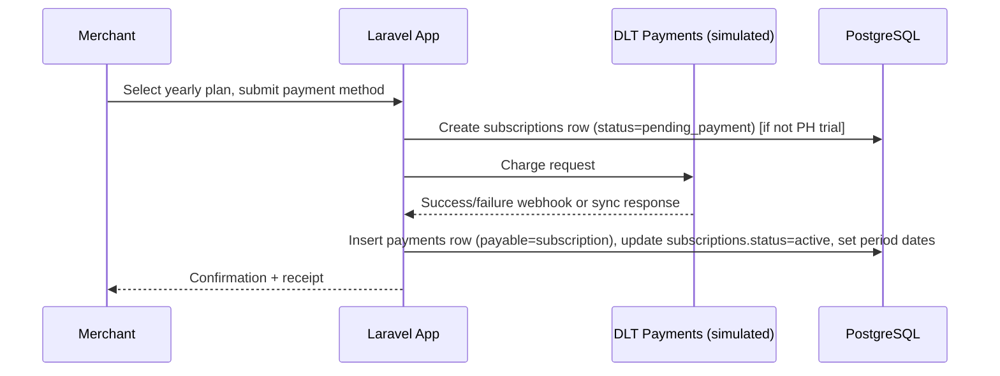

# design.md
## Technical Design Document — Phase 6: Subscription Model & Lead-Generation Pivot

| | |
|---|---|
| **Companion doc** | `Phase 6 requirements.md` |
| **Author role** | Lead Systems Architect |
| **Stack** | PHP/Laravel · Livewire · Tailwind · Redis · PostgreSQL · Reverb (active — powers retained chat) · Typesense · DLT Payments (reused for subscriptions) · Minio/S3 · Laravel Cloud |
| **Status** | Draft for engineering review |

---

## 1. Design principle: additive-only, flag-gated

Every change in this document is either (a) a **new table/column**, or (b) a **config-gated behavior change** on top of existing Phase 1–5 code. Nothing in Phase 2–4's schema is dropped, renamed, or repurposed to mean something else. Where an old field becomes unused (e.g., `shop_onboardings.halal_certification_body`), it is left in the schema, simply no longer written to by the new UI.

---

## 2. Feature flag registry

### 2.1 Config

```php
// config/marketplace.php
return [
    // ...existing keys (Phase 5)...
    'features' => [
        'payouts_enabled'           => env('MARKETPLACE_PAYOUTS_ENABLED', false),      // flips from true (P5 default) to false (P6 default)
        'orders_enabled'            => env('MARKETPLACE_ORDERS_ENABLED', false),
        'escrow_payments_enabled'   => env('MARKETPLACE_ESCROW_PAYMENTS_ENABLED', false),
        'fulfilment_enabled'        => env('MARKETPLACE_FULFILMENT_ENABLED', false),
        'disputes_enabled'          => env('MARKETPLACE_DISPUTES_ENABLED', false),
        'reviews_enabled'           => env('MARKETPLACE_REVIEWS_ENABLED', false),
        'quotations_enabled'        => env('MARKETPLACE_QUOTATIONS_ENABLED', false),
        'seller_rfq_queue_enabled'  => env('MARKETPLACE_SELLER_RFQ_QUEUE_ENABLED', false),
        // Note: chat is deliberately NOT in this list — it stays enabled in Phase 6
        // (retained per requirements.md §4.5/§5), just decoupled from RFQ auto-threading.

        // Phase 6 net-new capabilities, on by default
        'subscriptions_enabled'     => env('MARKETPLACE_SUBSCRIPTIONS_ENABLED', true),
        'certification_apply_enabled' => env('MARKETPLACE_CERTIFICATION_APPLY_ENABLED', true),
        'sponsored_content_enabled' => env('MARKETPLACE_SPONSORED_CONTENT_ENABLED', true),
        'admin_rfq_management_enabled' => env('MARKETPLACE_ADMIN_RFQ_MANAGEMENT_ENABLED', true),
    ],
];
```

### 2.2 Enforcement layers (defense in depth — all three, not one)

1. **Middleware** — `EnsureFeatureEnabled:orders_enabled` (etc.) applied to the relevant route groups in `routes/web.php`/`routes/api.php` (order routes, dispute routes, payout routes, review routes, quotation routes, the seller RFQ-received route group). Chat routes are deliberately **excluded** from this middleware — chat stays live. Returns `404` (not `403`, to avoid revealing the feature ever existed) when the flag is off.
2. **Policies** — every policy method gated by a disabled feature adds an early-return guard:
   ```php
   public function create(User $user, Order $order): bool
   {
       if (! config('marketplace.features.orders_enabled')) {
           return false;
       }
       // ...existing logic unchanged...
   }
   ```
   Applies to `OrderPolicy`, `DisputePolicy`, `PayoutPolicy` (already flag-aware per Phase 5 Task 1.1 — extend the same guard to its other methods, not just the `Schema::hasTable` calls it replaced), `QuotationPolicy`, `ReviewPolicy`, and the RFQ-received methods on the (seller-facing) `RfqPolicy`.
3. **UI conditionals** — Blade/Livewire nav partials (`company-hub-nav.blade.php`, `account-nav.blade.php`, `admin-nav.blade.php`) wrap the relevant links in `@if(config('marketplace.features.X'))`.

### 2.3 Scheduled jobs

Jobs tied to a disabled feature are still registered in the scheduler but **no-op immediately** if their flag is off, rather than being commented out of `routes/console.php` — this keeps the on/off behavior consistent with the "toggle a config, not a deploy" requirement (`requirements.md` §9):

```php
// app/Console/Commands/RunPayoutReleaseJob.php (existing, Phase 4)
public function handle(): int
{
    if (! config('marketplace.features.payouts_enabled')) {
        return self::SUCCESS; // no-op
    }
    // ...existing logic...
}
```

Same pattern applies to `SellerNoBidTimeoutJob` (retired — see §5) and `QuotationExpiryJob` (Phase 2 §8, gated by `quotations_enabled`).

---

## 3. Schema — new tables (DDL-level)

```sql
CREATE TABLE subscription_plans (
    id BIGSERIAL PRIMARY KEY,
    name VARCHAR NOT NULL,
    country_scope VARCHAR NULL,          -- ISO country code; NULL = all countries
    price NUMERIC(12,2) NOT NULL,
    currency VARCHAR(3) NOT NULL DEFAULT 'PHP',
    billing_period VARCHAR NOT NULL DEFAULT 'yearly',
    trial_days INT NULL,                  -- 180 for the PH plan variant
    is_active BOOLEAN NOT NULL DEFAULT true,
    created_at TIMESTAMP, updated_at TIMESTAMP
);

CREATE TABLE subscriptions (
    id BIGSERIAL PRIMARY KEY,
    shop_id BIGINT NOT NULL REFERENCES shops(id),
    subscription_plan_id BIGINT NOT NULL REFERENCES subscription_plans(id),
    status VARCHAR NOT NULL DEFAULT 'trialing', -- trialing|active|lapsed|cancelled
    trial_ends_at TIMESTAMP NULL,
    current_period_start TIMESTAMP NULL,
    current_period_end TIMESTAMP NULL,
    payment_id BIGINT NULL REFERENCES payments(id),  -- reuses Phase 3 payments table
    created_at TIMESTAMP, updated_at TIMESTAMP
);
CREATE INDEX ON subscriptions (shop_id, status);

CREATE TABLE certification_applications (
    id BIGSERIAL PRIMARY KEY,
    shop_id BIGINT NOT NULL REFERENCES shops(id),
    expiry_date DATE NOT NULL,
    media_id BIGINT NOT NULL REFERENCES media(id),
    status VARCHAR NOT NULL DEFAULT 'pending', -- pending|approved|rejected
    admin_notes TEXT NULL,
    reviewed_by BIGINT NULL REFERENCES users(id),
    reviewed_at TIMESTAMP NULL,
    created_at TIMESTAMP, updated_at TIMESTAMP
);

CREATE TABLE sponsored_content_tiers (
    id BIGSERIAL PRIMARY KEY,
    name VARCHAR NOT NULL,
    priority_weight INT NOT NULL DEFAULT 0,
    is_active BOOLEAN NOT NULL DEFAULT true,
    created_at TIMESTAMP, updated_at TIMESTAMP
);

CREATE TABLE sponsored_content (
    id BIGSERIAL PRIMARY KEY,
    sponsored_content_tier_id BIGINT NOT NULL REFERENCES sponsored_content_tiers(id),
    title VARCHAR NOT NULL,
    media_id BIGINT NOT NULL REFERENCES media(id),
    destination_url VARCHAR NOT NULL,
    starts_at TIMESTAMP NOT NULL,
    ends_at TIMESTAMP NOT NULL,
    is_active BOOLEAN NOT NULL DEFAULT true,
    created_by BIGINT NOT NULL REFERENCES users(id),
    created_at TIMESTAMP, updated_at TIMESTAMP
);

CREATE TABLE sponsored_content_placements (
    id BIGSERIAL PRIMARY KEY,
    sponsored_content_id BIGINT NOT NULL REFERENCES sponsored_content(id),
    placement_key VARCHAR NOT NULL  -- homepage|category_page|search_results
);

CREATE TABLE sponsored_content_events (
    id BIGSERIAL PRIMARY KEY,
    sponsored_content_id BIGINT NOT NULL REFERENCES sponsored_content(id),
    event_type VARCHAR NOT NULL,  -- impression|click
    occurred_at TIMESTAMP NOT NULL DEFAULT now()
);
CREATE INDEX ON sponsored_content_events (sponsored_content_id, event_type, occurred_at);

CREATE TABLE country_portals (
    id BIGSERIAL PRIMARY KEY,
    country_code VARCHAR(2) NOT NULL UNIQUE,
    display_name VARCHAR NOT NULL,
    is_active BOOLEAN NOT NULL DEFAULT true,
    sort_order INT NOT NULL DEFAULT 0
);
```

## 4. Schema — additive columns on existing tables

```sql
ALTER TABLE shop_onboardings
    ADD COLUMN company_description TEXT NULL,
    ADD COLUMN products_description TEXT NULL;

ALTER TABLE shops
    ADD COLUMN company_description TEXT NULL,
    ADD COLUMN products_description TEXT NULL,
    ADD COLUMN is_halal_certified BOOLEAN NOT NULL DEFAULT false,
    ADD COLUMN certified_expiry_date DATE NULL;

ALTER TABLE products
    ADD COLUMN moderation_status VARCHAR NOT NULL DEFAULT 'active'; -- active|flagged|admin_unpublished
```

`shop_onboardings`' old `halal_certification_body`, `halal_certificate_registration_number`, `halal_certificate_expiry_date` columns (Phase 1 §5.1) are **not touched** — left nullable/unused by the new wizard.

## 5. RFQ ownership transfer — implementation detail

Per `requirements.md` §8.3, the cleanest implementation keeps `rfq_recipients`' existing shape (still `shop_id`-scoped, since an RFQ still conceptually targets one seller/shop even though the seller no longer acts on it) and adds an **admin-management layer on top** rather than repointing the foreign key to a user/admin table:

```sql
ALTER TABLE rfq_recipients
    ADD COLUMN admin_status VARCHAR NULL,     -- received|in_progress|resolved|closed (admin's own status track)
    ADD COLUMN admin_notes TEXT NULL,
    ADD COLUMN managed_by BIGINT NULL REFERENCES users(id); -- admin user currently/last handling it
```

- `rfq_recipients.status` (Phase 2's original seller-facing enum: `received`/`reviewed`/`in_progress`/`no_bid`) is **left in place but frozen** — no longer written to while `seller_rfq_queue_enabled` is off. All Phase 6 admin RFQ management reads/writes `admin_status`/`admin_notes`/`managed_by` instead.
- `RfqAutoCloseJob` (Phase 2 §8) is updated to check `admin_status`/buyer activity instead of seller `rfq_recipients.status`/buyer activity, only when `admin_rfq_management_enabled` is on.
- `SellerNoBidTimeoutJob` is retired (no-ops) since there's no seller action to time out; it is not deleted, per §1's additive-only principle — it simply becomes dead code behind `seller_rfq_queue_enabled`.
- **Chat/RFQ decoupling**: the RFQ submission handler's call to `ConversationService::openThreadForRfq()` (Phase 2's auto-thread-on-RFQ behavior) is removed from the RFQ creation path. `conversations`/`conversation_threads`/`messages` and their controllers/Livewire components are otherwise untouched and remain fully active — a buyer can start a conversation with a seller directly (new entry point: "Message this company" on the storefront company page, per `requirements.md` §2), independent of any RFQ.

## 6. Subscription payment — reusing the DLT ledger

`payments` (Phase 3) gains a `payable_type`/`payable_id` polymorphic pair if it doesn't already support one, or an explicit `subscription_id` nullable FK if the existing table is order-specific — confirmed against the actual Phase 3 `payments` schema during implementation. The `subscription` payment flow:



PH trial path skips the DLT call entirely: `subscriptions` row is created directly with `status=trialing`, `trial_ends_at = now()+180 days`, `payment_id = null`.

## 7. Search index changes

`IndexProductJob` (Phase 1 §7.3) gains a pre-check:

```php
if (! $product->shop->hasActiveOrTrialingSubscription()
    || $product->shop->status !== 'active'
    || $product->moderation_status !== 'active') {
    Typesense::deleteFromIndex($product);
    return;
}
```

`hasActiveOrTrialingSubscription()` is a new `Shop` model accessor: `subscriptions()->whereIn('status', ['active','trialing'])->exists()`. This job re-runs on subscription status change (new event: `SubscriptionStatusChanged`) in addition to its existing triggers.

## 8. Localization

- Static strings: standard Laravel `lang/{locale}/*.php`, `App::setLocale()` driven by a session/user-preference locale, exposed via a storefront locale switcher component.
- Admin/merchant-authored content that may need multi-locale variants (sponsored content title/creative copy, country-portal display names) uses JSON-cast translatable columns (`spatie/laravel-translatable` pattern: `title->en`, `title->ms`, etc.) rather than a separate `translations` table, to keep query complexity down for a first pass.
- Currency/date formatting keyed off the viewer's resolved locale via Laravel's `Number`/`Carbon` locale-aware formatters.

## 9. Admin surfaces — routes summary

| Route | Purpose |
|---|---|
| `GET /admin/certifications` | Certification application queue (§ requirements 4.2) |
| `POST /admin/certifications/{id}/approve` \| `/reject` | Review decision |
| `GET /admin/subscriptions` | Subscription tracking (filter by status/plan/country) |
| `GET /admin/merchants` | Merchant management list |
| `POST /admin/merchants/{id}/suspend` \| `/reactivate` | §4.6 actions |
| `GET /admin/products/moderation` | Product moderation queue |
| `POST /admin/products/{id}/flag` \| `/unpublish` \| `/restore` | §4.7 actions |
| `GET /admin/rfqs` | Admin RFQ management (replaces seller "RFQs Received") |
| `POST /admin/rfqs/{id}/status` | Update `admin_status`/`admin_notes` |
| `GET/POST /admin/sponsored-content` | CRUD for sponsored content (§4.8) |

## 10. Permissions additions

| Role | New permissions |
|---|---|
| `admin` | `subscription.manage`, `certification.review`, `sponsored_content.manage`, `rfq.manage`, `merchant.manage`, `product.moderate` |
| `seller` | *(no new permissions; `rfq.received.*` permissions from Phase 2 are retained in the permission table for future re-enable but not granted by default while `seller_rfq_queue_enabled` is off)* |

---

## 11. Rollback plan

Flipping any flag in §2.1 back to `true` restores prior behavior with no data migration required, **except**:
- `escrow_payments_enabled`/`orders_enabled`: any subscription-payment-only changes to the shared `payments` table (payable-type discriminator, §6) must not break existing order-payment rows — verified via a Phase-6 regression test asserting Phase 3 order-payment queries still return correct rows once the discriminator column exists.
- `seller_rfq_queue_enabled`: re-enabling restores the seller queue reading `rfq_recipients.status`, which was frozen (not written) during Phase 6 — any RFQs that only progressed via `admin_status` while the flag was off will show as still `received` on the seller side until manually reconciled. Flagged as a known gap for whoever re-enables this flag.
