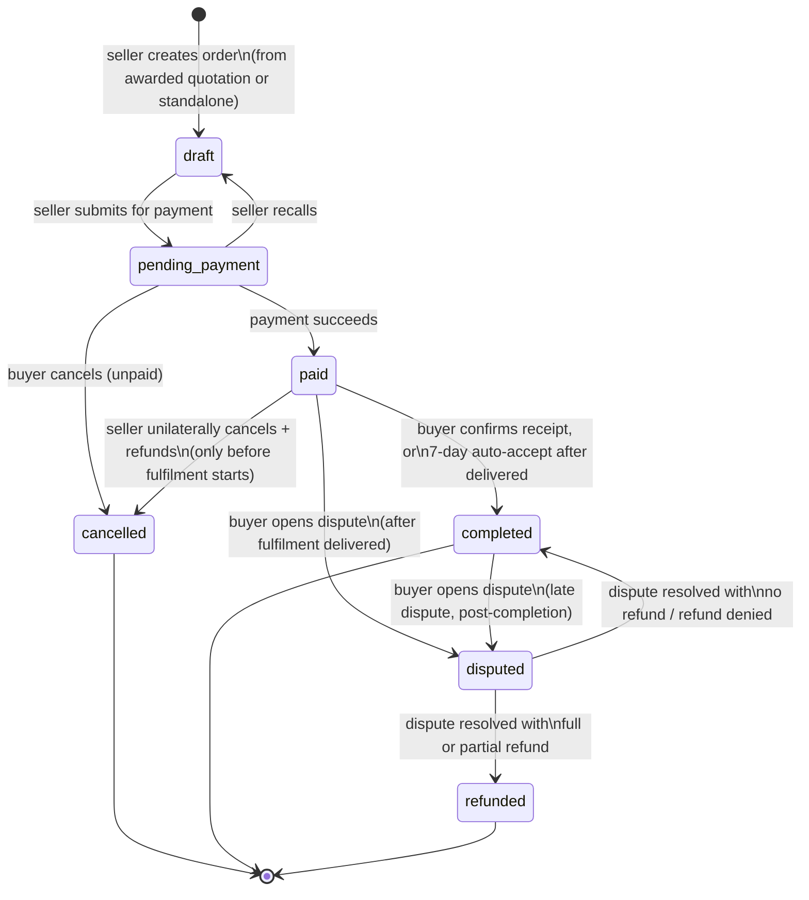
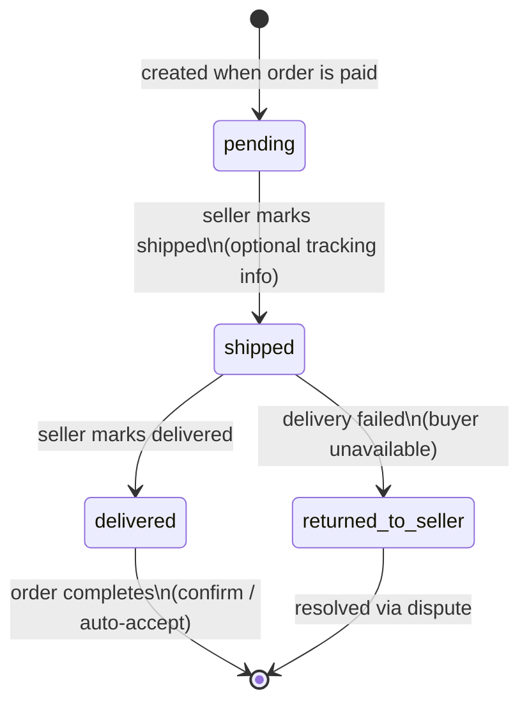
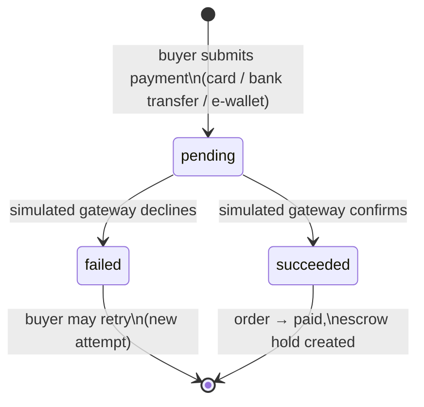
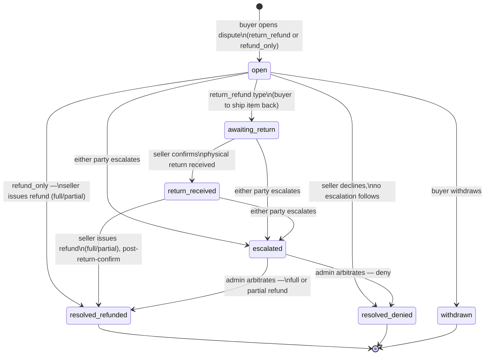

# Product Requirements Document
## Phase 3 — Orders & Payments (Orders, Escrow, Fulfilment, Disputes)

| | |
|---|---|
| **Companion docs** | `Phase-1-Halal-B2B-Directory-PRD.md`, `Phase-2-Negotiation-PRD.md`, `design.md` (Phase 1 & 2) |
| **Phase** | 3 of 3 — Orders & Payments |
| **Doc status** | Draft for review |
| **Owner** | Product / Engineering |

---

## 1. Overview

### 1.1 Product context

Phase 1 delivered **discovery** (verified halal company/product directory). Phase 2 delivered **negotiation** (RFQ, quotation, chat). Phase 3 closes the loop:

> *Can two businesses discover each other, negotiate, place an order, pay securely, deliver goods, and leave feedback?* — Phase 3 answers "place an order, pay securely, deliver goods" (feedback/reviews remain out of scope, see §1.4).

Phase 3 introduces **orders** as the transactional record that consumes an **awarded quotation** (or is created standalone by a seller directly against an existing customer), takes **full payment upfront into escrow**, tracks **fulfilment**, and gives both parties a **dispute** mechanism when something goes wrong. Money movement (buyer charge, seller payout, buyer refund) is handled by a **custom, simulated payment gateway** for v1 — no real processor integration yet — backed by an internal **ledger** for auditability.

### 1.2 Problem statement

An awarded quotation is just an agreed price — it isn't yet a committed, paid, trackable transaction. Phase 3 gives sellers a way to finalize exactly what's being sold (items, fees, customer details) before money changes hands, gives buyers a secure way to pay knowing funds are held in escrow rather than released immediately, gives sellers a straightforward single-shipment fulfilment workflow, and gives both parties a bounded, admin-backed way to resolve problems (wrong item, damaged goods, non-delivery) without either side being able to unilaterally walk away with the other's money or goods.

### 1.3 Goals

- Let a seller **finalize an order** — sourced from an awarded quotation, or created standalone directly against an existing customer — making last changes to customer/billing/shipping details, order items, and additional fees, while it's still a `draft`.
- Let a buyer **pay in full** for a submitted order via a simulated payment gateway (card, bank transfer, e-wallet), with funds **held in escrow** rather than paid out immediately.
- Let a seller **fulfil** an order (mark shipped, provide tracking, mark delivered) and let a buyer **track and confirm receipt**, with a **7-day auto-accept** safety net if the buyer takes no action.
- Give buyer and seller an **order thread** in their existing chat conversation, mirroring the Phase 2 RFQ-thread pattern.
- Let a buyer **open a dispute** (return & refund, or refund only) when something goes wrong, with **seller-first resolution** and **admin arbitration only on escalation**.
- Simulate **fund movement** (escrow hold → seller payout, or buyer refund) through an internal ledger, laying groundwork for a real payment gateway integration later.
- Give sellers a **Seller Hub** command center: an action-oriented dashboard, a customer list, sales/fulfilment reports, and leaderboards.
- **Data-model for the future** without building it now: multiple payment terms (deposits/partials) and multiple fulfilments per order.

### 1.4 Non-goals (out of scope for Phase 3 v1)

- Real payment processor integration (Stripe/PayMongo/etc.) — the gateway is fully simulated.
- Multiple partial payments / deposit schedules — v1 is always one full payment per order (see §6 for forward-compatible modeling).
- Multiple fulfilments/shipments per order — v1 is exactly one fulfilment record per order (see §6).
- Third-party courier integration (rate shopping, label printing, webhook tracking updates) — tracking info in v1 is seller-entered, and delivery status is seller-marked manually.
- Buyer/seller reviews & ratings (implied by the phase-1 north-star question's "leave feedback," but not stated in the Phase 3 brief — flagged in §11 as a likely Phase 4).
- Replacement orders as a distinct dispute *outcome* — a replacement is handled as an entirely new order, not a system-tracked resolution type.
- Platform commission/take-rate *configuration* UI — a commission is assumed to exist for "net sales" reporting purposes (§4.8), but its computation/schedule is out of scope to configure in v1 (flat/placeholder rate).
- Multi-seat company hub (seller-side team members) — carried over as an open question from Phase 2, still unaddressed here.

### 1.5 Success metrics

- Quotation-award → order-submitted conversion rate and time-to-submit (seller finalization speed).
- Order-submitted → paid conversion rate and time-to-pay (buyer payment friction).
- % of orders auto-completed by the 7-day inspection timeout vs. explicitly confirmed by the buyer.
- Dispute rate (disputes / completed+disputed orders), and % of disputes resolved seller-to-buyer vs. escalated to admin.
- Payment success/failure rate by simulated method (signal for gateway UX, even simulated).
- Average escrow hold duration (payment → release), as a proxy for fulfilment speed.

---

## 2. Users & Portals

| Portal | User | Phase 3 additions |
|---|---|---|
| **Buyer / User Account** | Buyer | "My Orders" (To pay / To ship / To receive / Completed / Disputes tabs), order detail, pay action, confirm-receipt action, dispute creation & thread |
| **Company Hub / Dashboard** | Seller | Order finalization (draft builder), order queue, fulfilment actions (ship/deliver/mark-returned), dispute inbox, Seller Hub (dashboard, customers, reports, leaderboards) |
| **Sitefront (Storefront)** | Public / buyer | No new functional surface — orders are not publicly discoverable |
| **Admin** | Internal ops | New: **dispute arbitration queue** (only sees escalated disputes) |

### 2.1 Customer list (seller-facing)

A seller's "customers" are buyers (`users`) who have at least one `orders` row (in any status) or an awarded `quotations` row with that seller's shop — i.e., anyone the seller has transacted or is transacting with. This list is the entry point for a seller creating a **standalone order** (§4.1) without an underlying quotation.

---

## 3. Functional Requirements

1. An order is created by a seller in `draft` status, either (a) auto-populated from an **awarded quotation** (items, pricing, and buyer snapshot copied in as a starting point), or (b) created standalone by the seller against an existing customer from their customer list.
2. While `draft`, a seller can freely edit: customer contact details, billing/shipping address, order line items (add/remove/change items, quantities, prices — full control, not restricted to the originating quotation's items), and additional fees (shipping, other named fees).
3. A seller **submits** a draft order for payment, moving it to `pending_payment` — at which point content is locked from further editing.
4. A seller may **recall** a `pending_payment` order back to `draft` to make further changes, as long as it has not yet been paid.
5. A buyer pays the **full order total** (items + fees) via the simulated payment gateway (card, bank transfer, or e-wallet). A successful payment is the buyer's approval of the order and moves it to `paid`; funds are held in **escrow**.
6. Once `paid`, order content (items, fees, customer/billing/shipping details) is permanently locked — no further edits by either party.
7. A buyer can **cancel** an order themselves only while it is `pending_payment` (unpaid). Once paid, a buyer cannot self-cancel.
8. A seller can **unilaterally cancel and refund** a `paid` order at any time **before fulfilment has started** (i.e., before a fulfilment record is created/shipped) — this reverses the escrow hold back to the buyer.
9. Once fulfilment has started (a fulfilment record exists and has been marked shipped or beyond), the order can **no longer be cancelled** by either party — only **disputed**.
10. A seller fulfils a `paid` order by creating its (one, for v1) **fulfilment** record and marking it **shipped** (with optional tracking info), then later marking it **delivered**, or — if delivery fails due to buyer unavailability — marking it **returned to seller**.
11. The buyer's order-tracking tab shows a **"Track order"** call-to-action while the fulfilment is not yet `delivered`, and switches to **"Confirm receipt"** once it is.
12. When a buyer **confirms receipt**, escrow funds are released to the seller and the order becomes `completed`.
13. If the buyer takes no action for **7 days after delivery**, the system auto-confirms receipt on the buyer's behalf, releasing escrow to the seller and completing the order.
14. A buyer can **open a dispute** against a `delivered` (or later) order, of type **return & refund** or **refund only**. Opening a dispute **pauses the 7-day auto-accept timer**.
15. Dispute resolution is **seller-first**: buyer and seller communicate (via the order's chat thread) and the seller can directly resolve the dispute by issuing a refund (full or partial) — for **return & refund** disputes, this requires the seller to first confirm receipt of the physically-returned item.
16. Either party may **escalate** an unresolved dispute to **admin arbitration**; admin is not otherwise involved in disputes. Admin may resolve an escalated dispute with a full refund, partial refund, or refund denial — a terminal, binding decision.
17. Every order has its **own thread** within the existing buyer–seller conversation (Phase 2 pattern), where order status changes render as an attached card alongside regular messages.
18. All fund movement (escrow hold, seller payout, buyer refund) is simulated via a custom payment gateway and recorded in an internal **ledger** for auditability.
19. The Seller Hub provides: a **to-do dashboard** (counts of RFQs, in-progress orders, unfulfilled orders, draft orders, open disputes, etc.), a **customers list**, **reports** (sales/fulfilment metrics over a selectable window), and **leaderboards** (top products/customers/categories, selectable ranking and time window).

---

## 4. Detailed Feature Specifications

### 4.1 Order creation

**From an awarded quotation** (primary path):
- Entry point: buyer's "Award" action on a quotation (Phase 2) surfaces a **"Create Order"** action for the seller (or the seller initiates it from the awarded quotation's card/detail view).
- On creation, the order is stamped `draft` and pre-populated from the quotation:
  - Order items ← quotation line items (description, quantity, unit, unit price, subtotal) — copied as a starting point, **fully editable**.
  - Customer/billing/shipping snapshot ← the quotation's own buyer snapshot (Phase 2 §4.5), **editable**.
  - `quotation_id` set on the order (nullable FK — see below).
- An awarded quotation can be converted into **at most one** order in v1 (no accidental duplicate orders from the same award).

**Standalone (no quotation)**:
- A seller can start a new order directly from the **Customers list** (§2.1) or an existing customer's profile within the Company Hub, without an underlying quotation.
- The seller selects the customer, then manually enters/edits customer contact, billing/shipping address (pre-filled from that buyer's latest known snapshot where available, e.g., their most recent order or quotation with this seller, but always editable), and builds order items from scratch.
- `quotation_id` is `NULL` for standalone orders. This is also the documented workaround for "replacements" — a replacement is simply a new standalone order, not a dispute-resolution type (§1.4).

### 4.2 Draft editing & submission

- While `draft`: seller can edit everything — customer contact, billing address, shipping address, order items (add/remove/edit/reorder), and additional fees (§4.3). No expiry — a draft order can sit indefinitely until the seller submits it or deletes it.
- **Submit for payment**: seller action moves `draft` → `pending_payment`. From this point, the order is visible to the buyer (drafts are seller-only/invisible to the buyer) and locked from seller edits.
- **Recall to draft**: seller action moves `pending_payment` → `draft`, re-enabling edits. Only possible before payment succeeds; once `paid`, recall is no longer available (content is permanently locked).
- **Buyer approval model**: there is no separate buyer "approve" step — the buyer sees the finalized order total and line items on the payment screen, and **paying the order is itself the buyer's approval** of the seller's final version.

### 4.3 Order items & fees

- **Order items**: description, quantity, unit, unit price, subtotal, sort order — same shape as Phase 2 `quotation_items`, decoupled once copied (editing an order item never touches the source quotation).
- **Order fees**: seller-added named charges (e.g., "Shipping", "Packaging", "Rush fee") — label + amount, unlimited count, editable only while `draft`.
- **Order total** = sum(order item subtotals) + sum(order fees). This is the single amount charged and held in escrow — v1 does not split or partially release any portion of it (see §4.5).

### 4.4 Customer/billing/shipping snapshot

- The order carries its own snapshot (business name, contact phone/email, billing address, shipping address) — separate storage from the quotation's or buyer profile's snapshot, since the seller may edit it during finalization.
- Editable while `draft`; locked at `paid`. (Unlike quotations, which snapshot once at submission and never change, an order's snapshot can be edited multiple times across draft↔pending_payment recalls — only the final `paid`-time state matters for the audit record.)

### 4.5 Payment & escrow

- **Simulated gateway**: supports **card**, **bank transfer**, and **e-wallet** as selectable simulated payment methods. Each produces a realistic-feeling flow (e.g., card → instant simulated auth; bank transfer / e-wallet → simulated "awaiting confirmation" delay) before resolving.
- **Payment attempt lifecycle**: `pending` (submitted to simulated gateway, awaiting simulated confirmation) → `succeeded` or `failed`. A `failed` attempt does not change the order's status — the buyer can retry (new payment attempt) as many times as needed while the order is `pending_payment`.
- A `succeeded` payment attempt moves the order to `paid` and creates an **escrow hold** ledger entry for the full order total.
- **Held together, released together**: item totals and fees are charged and escrowed as one lump sum — v1 never partially releases or splits the escrowed amount.
- **Release**: on buyer confirm-receipt (explicit or 7-day auto-accept), the full escrowed amount is released to the seller (minus platform commission, for reporting purposes — see §4.8) via a simulated **payout**, and the order becomes `completed`.
- **Refund** (cancellation or dispute resolution): the escrowed amount (full or partial, per resolution) is reversed to the buyer via a simulated **refund**; any remainder (in a partial-refund dispute outcome) is paid out to the seller.

### 4.6 Fulfilment

- **One fulfilment per order in v1** (data-modeled to support many later — see §6).
- Seller creates the fulfilment record when ready to ship, optionally entering **tracking info**: carrier (free text), tracking code, tracking URL, and shipped date — all optional (no real courier integration; sellers may not always have formal tracking to give).
- **Two distinct seller actions**, not one: **Mark shipped** (fulfilment now "on its way") and **Mark delivered** (item has arrived) — done separately, at whatever time the seller has confirmation of each.
- **Mark returned to seller**: a third seller action for when delivery failed due to buyer unavailability. This does not re-open cancellation (fulfilment has already started); it's a signal that the shipment is back with the seller and the order now needs to be resolved via dispute (either party can open one) since the buyer never received the goods.
- Buyer-facing CTA in the "To receive" tab: **"Track order"** while fulfilment status is anything before `delivered`; **"Confirm receipt"** once `delivered`.

### 4.7 Customer order experience (tabs)

| Tab | Order/fulfilment condition |
|---|---|
| **To pay** | `pending_payment` |
| **To ship** | `paid`, and fulfilment is not yet created or fulfilment status is `pending`/`shipped`... — see note below |
| **To receive** | fulfilment status is `shipped` or `delivered` (CTA switches per §4.6) |
| **Completed** | order status `completed` |
| **Disputes** | order has a dispute in a non-terminal state (`open`, `awaiting_return`, `return_received`, or `escalated`) — cuts across the other tabs; a disputed order is *removed* from To ship/To receive while the dispute is open |

> **Tab boundary note**: "To ship" and "To receive" are effectively split by whether the fulfilment has been marked **shipped** yet — before that, the order sits in "To ship" (seller hasn't shipped); once marked shipped, it moves to "To receive" (buyer now tracks/awaits, then confirms). This reconciles the spec's literal instruction ("when seller fulfils order, items move from 'to ship' to 'to receive'") with the two-action shipped/delivered model in §4.6.

### 4.8 Disputes

- **Types**: **Return & refund** (buyer ships the item back; refund follows confirmed return) and **refund only** (no physical return expected/required).
- **Eligibility**: a dispute can be opened any time after the fulfilment reaches `delivered` — including after the order has already auto-completed and funds released to the seller. There is no hard cutoff window; late disputes are still allowed, but the buyer is expected to first align with the seller directly (per §4.8.1) since funds may have already moved.
- **Opening a dispute** pauses the 7-day auto-accept timer (if not already completed) and creates a dedicated dispute record + surfaces in the order's chat thread.
- **Admin is not involved by default.** The normal path is buyer and seller settling directly:
  - **Refund only**: the seller can directly issue a refund (full or partial) to resolve the dispute — no physical step required.
  - **Return & refund**: the buyer ships the item back to the seller **off-platform** (v1 does not track a return-shipment courier integration); once the seller physically receives it, the seller **confirms receipt** in-system, which is the trigger that allows the seller to then issue the refund (full or partial) and resolve the dispute. A refund cannot be system-processed for a return-type dispute until the seller has confirmed the return.
- **Escalation**: if buyer and seller cannot agree (seller refuses, disputes the claim, or is unresponsive; or the buyer disagrees with the seller's proposed resolution), **either party can escalate** to admin. Admin then arbitrates: full refund, partial refund, or deny (order stands, no refund) — a terminal, binding decision, executed immediately against escrow.
- A dispute can be **withdrawn** by the buyer at any point before resolution (e.g., they resolved it informally and don't need platform action) — returns the order to its prior state (funds release resumes per whatever timer/action would otherwise apply).
- **Replacement** is explicitly not a dispute outcome — the documented path is a brand-new order (§4.1), independent of the disputed one.

### 4.9 Order thread (chat)

- Mirrors the Phase 2 RFQ-thread pattern exactly: `conversation_threads` gains an optional `order_id` (alongside the existing optional `rfq_id`), so an order gets its own thread within the same persistent buyer–seller `conversations` row used since Phase 2.
- The order (and its dispute, if any) renders as an **attached card** in that thread, reflecting current status at a glance — same `message_cards` polymorphic mechanism as RFQ/quotation cards, extended to reference `orders` and `disputes`.
- No new conversation is created — if a buyer–seller conversation already exists (from a prior RFQ or message), the order thread is simply a new thread inside it.

### 4.10 Seller Hub

- **Dashboard — to-do widget**: action-required counts, e.g., *N new RFQs, N orders in progress, N unfulfilled orders, N draft orders, N open disputes* — each a deep link into the relevant filtered queue.
- **Customers list**: see §2.1 — buyers this seller has an order or awarded quotation history with; entry point for standalone order creation.
- **Reports**: over a selectable window ("last N days"): customers (new/returning count), orders (count placed), items purchased (quantity), fulfilled quantities, **gross sales** (sum of paid order totals), **net sales** (gross minus refunds minus platform commission — i.e., what the seller actually earned), and total refund amount.
- **Leaderboards**: top products, top customers, top categories — each rankable by **revenue**, **order count**, or **quantity sold**, over either **all-time** or a selectable **last-N-days** window.

---

## 5. State Machines

### 5.1 Order (master record)



- `draft` and `pending_payment` are mutable/interchangeable (via submit/recall); everything from `paid` onward is content-locked.
- `disputed` is best modeled as an overlay flag on the order (an open `disputes` row) rather than strictly replacing the underlying `paid`/`completed` status — see §6 (an order can be "completed, with an open dispute" for the late-dispute case).
- `refunded` covers both a full-refund and partial-refund dispute outcome; a partial refund still pays out the remainder to the seller.

### 5.2 Fulfilment (per order — one in v1)



- `returned_to_seller` is a dead end for fulfilment itself — resolution happens at the order level via a dispute (§4.8), since the buyer never received the goods but fulfilment has technically "started" (no cancellation available per §3.9).

### 5.3 Payment attempt



- Multiple `payment_attempts` rows can exist per order (one per try); only one may ever be `succeeded`.

### 5.4 Dispute



---

## 6. Data Model (conceptual)

Full DDL belongs in a Phase 3 addendum to `design.md`; this section defines the entities, relationships, and the forward-compatibility shape requested for future releases.

| Entity | Purpose | Key relationships |
|---|---|---|
| `orders` | The master order record | belongs to `users` (buyer), `shops` (seller); optionally belongs to `quotations` (nullable FK); carries its own customer/billing/shipping snapshot |
| `order_items` | Line items within an order | belongs to `orders` (1:N); decoupled copy of quotation items where applicable |
| `order_fees` | Additional named charges (shipping, other) | belongs to `orders` (1:N) |
| `order_payment_terms` | **Forward-compatible payment schedule** — v1 always creates exactly one row (`type = full`, 100% of order total) | belongs to `orders` (1:N; future: `deposit`/`partial` rows) |
| `payment_attempts` | Each simulated gateway charge attempt against a payment term | belongs to `order_payment_terms` (1:N) |
| `fulfilments` | Shipment/fulfilment record | belongs to `orders` (1:N schema, but exactly 1 enforced at application layer in v1) |
| `disputes` | A buyer-raised dispute against an order | belongs to `orders` (1:N — an order could theoretically have sequential disputes over time, e.g., withdrawn then reopened) |
| `ledger_entries` | Simple transaction log for all simulated fund movement | belongs to `orders` (1:N); types: `escrow_hold`, `payout`, `refund` |
| `conversation_threads` | *(Phase 2, extended)* | gains an optional nullable `order_id` FK alongside existing `rfq_id` |
| `message_cards` | *(Phase 2, extended)* | polymorphic reference extended to also cover `orders` and `disputes` |

### 6.1 Relationship summary

```
users (buyer) 1───N orders ───N:1 shops (seller)
quotations 0:1───N orders               (nullable — standalone orders have none)
orders 1───N order_items
orders 1───N order_fees
orders 1───N order_payment_terms 1───N payment_attempts
orders 1───N fulfilments                (schema 1:N, app-enforced 1:1 for v1)
orders 1───N disputes
orders 1───N ledger_entries
conversations 1───N conversation_threads ───0:1 rfqs
                                          └──0:1 orders
messages 0:1───message_cards ───polymorphic─→ rfqs | quotations | orders | disputes
```

### 6.2 Forward-compatibility notes

- **Multiple payment terms (deposits/partials)**: `order_payment_terms` exists from day one even though v1 always creates a single `full` row covering 100% of the order total. A future release adds `deposit`/`partial` term types, each with its own portion of the total and its own `payment_attempts`; the order only moves past `pending_payment` once all required terms are satisfied. This avoids a schema migration later — v1 just never populates more than one row.
- **Multiple fulfilments per order**: `fulfilments` is already a child table (`order_id` FK, not a 1:1 column on `orders`), even though v1's application layer only ever allows one per order (enforced by a unique constraint or app-level check, not architecture). A future release (e.g., split shipments) simply relaxes that constraint — no new table needed.
- **Escrow/ledger**: modeled as a simple transaction log (`order_id`, `type`, `amount`, `status`, timestamps) rather than a double-entry accounting structure — sufficient for simulated fund movement and reporting in v1; a future real-gateway integration may warrant a fuller double-entry ledger with dedicated escrow/payable/refundable accounts, noted as an open question in §11.

---

## 7. Key User Flows

### 7.1 Happy path (from awarded quotation)

1. Buyer awards a quotation (Phase 2). Seller sees a **Create Order** action.
2. Seller creates the order → `draft`, pre-populated from the quotation's items and buyer snapshot.
3. Seller finalizes: adjusts an item, adds a "Shipping" fee, corrects the shipping address → still `draft`.
4. Seller **submits for payment** → `pending_payment`; order now visible to the buyer in "To pay," and an order thread opens (or reuses the existing conversation).
5. Buyer pays via simulated card → payment attempt `succeeded` → order `paid`, escrow hold recorded; order moves to "To ship."
6. Seller creates the fulfilment, marks **shipped** with tracking info → order moves to "To receive" (buyer sees "Track order").
7. Seller later marks **delivered** → buyer's CTA switches to "Confirm receipt."
8. Buyer confirms receipt → escrow released to seller (payout ledger entry) → order `completed`.
9. *(No dispute in this path.)*

### 7.2 Auto-accept path

1–7 as above, but the buyer takes no action after delivery.
8. 7 days pass with no buyer action → system auto-confirms receipt → escrow released, order `completed`.

### 7.3 Standalone order (no quotation)

1. Seller opens an existing customer from their **Customers list** in the Company Hub.
2. Seller creates a new order for that customer → `draft`, manually builds items and fees, edits shipping details as needed.
3. Continues as 7.1 steps 4–8.

### 7.4 Buyer cancels before payment

1. Order is `pending_payment`. Buyer decides not to proceed and cancels it in-app.
2. Order → `cancelled`. No payment was ever taken, so no escrow/refund ledger entries are needed.

### 7.5 Seller cancels a paid, unfulfilled order

1. Order is `paid`, no fulfilment created yet. Seller decides to cancel (e.g., out of stock).
2. Seller cancels → order `cancelled`, full escrow amount refunded to buyer (refund ledger entry).

### 7.6 Dispute — return & refund, resolved without admin

1. Order `delivered`; buyer inspects the item, finds it defective, opens a dispute (**return & refund**) with a reason and photos. 7-day timer pauses.
2. Buyer and seller message in the order thread; buyer ships the item back off-platform.
3. Seller receives the physical return, marks **return received** in-system.
4. Seller issues a full refund → dispute `resolved_refunded`, escrow refunded to buyer in full → order `refunded`.

### 7.7 Dispute — refund only, escalated to admin

1. Order `completed` (already auto-accepted); buyer later notices a billing discrepancy and opens a **refund only** dispute (late dispute, allowed).
2. Seller disputes the buyer's claim, no agreement reached in chat.
3. Buyer escalates to admin.
4. Admin reviews the order, thread history, and dispute reason → decides a **partial refund** → system executes: refund portion to buyer, remainder (already paid out) stands with the seller → dispute `resolved_refunded`, order `refunded`.

### 7.8 Delivery failure

1. Fulfilment marked `shipped`; delivery attempt fails due to buyer being unavailable.
2. Seller marks fulfilment **returned to seller**.
3. Since fulfilment has started, the order can't be cancelled — either buyer or seller opens a dispute to resolve (typically **refund only**, since the goods never left the seller's possession in a meaningful sense) and it proceeds per §7.6/§7.7.

---

## 8. Background Jobs & Notifications

| Job | Schedule | Logic |
|---|---|---|
| `OrderAutoAcceptJob` | Daily (or more frequent) | Scan orders with fulfilment `delivered`, `delivered_at` ≥ 7 days ago, no active dispute → auto-confirm receipt, release escrow, set `completed` |
| `PaymentAttemptSettlementJob` | Near-real-time (queued on submission) | Resolves a simulated `pending` payment attempt to `succeeded`/`failed` after a simulated processing delay (bank transfer / e-wallet) |
| `DisputeEscalationReminderJob` *(optional)* | Daily | Nudges buyer/seller on disputes sitting `open`/`awaiting_return`/`return_received` with no activity, surfacing the escalate option |

**Notifications** (real-time via Reverb + email, per Phase 1/2 convention), triggered on:
- Order submitted for payment (buyer)
- Payment succeeded / failed (buyer; seller on succeeded)
- Order shipped / delivered (buyer)
- Buyer confirmed receipt / auto-accept fired (seller)
- Order cancelled — by buyer or seller (counterpart)
- Dispute opened / return confirmed / resolved / escalated (relevant counterpart, and admin on escalation)
- New order-thread chat message (both parties)

---

## 9. Non-Functional Requirements

| Category | Requirement |
|---|---|
| **Financial integrity** | Escrow hold, payout, and refund ledger entries must be atomic with the order/dispute status transition that triggers them (single DB transaction) — no order can reach `paid`/`completed`/`refunded` without a matching, consistent ledger entry. |
| **Auditability** | Order, fulfilment, and dispute history must remain queryable indefinitely (no hard deletes); the order's locked-at-`paid` snapshot must be reconstructable as of that moment. |
| **Idempotency** | `OrderAutoAcceptJob` and `PaymentAttemptSettlementJob` must be safe to run repeatedly without double-releasing escrow or duplicating notifications. |
| **Consistency** | Dispute resolution (seller-issued or admin-arbitrated) must apply its ledger movement and terminal status change atomically. |
| **Data privacy** | Order billing/shipping/contact details are visible only to the buyer, the specific seller, and admin staff handling an escalated dispute — never exposed elsewhere. |
| **Realtime** | Order status changes and chat messages should reach an open session within a UX-acceptable latency (target: <2s) via Reverb, consistent with Phase 2. |

---

## 10. Milestones (indicative)

| Milestone | Includes |
|---|---|
| M1 — Order creation | `orders`, `order_items`, `order_fees`, `quotation_id` linkage, standalone creation from customer list, draft editing |
| M2 — Submission & payment | `pending_payment`/recall flow, `order_payment_terms` (single full-term row), simulated gateway (card/bank/e-wallet), `payment_attempts`, escrow hold ledger entry |
| M3 — Fulfilment | `fulfilments` (ship/deliver/returned-to-seller actions, tracking fields), buyer To-ship/To-receive tabs and CTA switch |
| M4 — Completion & cancellation | Confirm-receipt action, 7-day auto-accept job, payout ledger entry, buyer pre-payment cancel, seller pre-fulfilment cancel + refund |
| M5 — Disputes | `disputes`, return/refund-only flows, seller-resolution path, admin escalation queue + arbitration, timer-pause logic |
| M6 — Order thread | `conversation_threads.order_id`, order/dispute cards via `message_cards` |
| M7 — Seller Hub | Dashboard to-do widget, customers list, reports, leaderboards |

---

## 11. Open Questions / Risks

1. **Partial refund authority pre-escalation**: the brief confirms admin can issue partial refunds on escalation, and sellers can resolve disputes directly — but whether a seller may offer a *partial* refund on their own (vs. only full) before any escalation is inferred, not explicitly stated. Assumed yes (seller has full discretion up to the escrowed amount) — confirm before implementation.
2. **Return shipment tracking**: return & refund disputes rely on the buyer shipping off-platform and the seller manually confirming receipt — there's no return-tracking-number field modeled. Consider adding one (optional) for the seller's own record-keeping, mirroring forward fulfilment's tracking fields.
3. **Platform commission**: net-sales reporting (§4.8) assumes a platform commission exists and is deducted, but its rate/schedule is unspecified — flagged as needing a source of truth (flat config value vs. per-category vs. per-shop) before the reports/leaderboard revenue figures can be built.
4. **Reviews/ratings**: the Phase 1 north-star question ends in "...leave feedback," which Phase 3 doesn't address. Likely a Phase 4, but flagging so it isn't assumed silently in scope here.
5. **Late-dispute funds already paid out**: §7.7 assumes a partial refund after payout is a ledger reversal (seller owes back a portion) rather than a fresh charge to the buyer — needs a concrete mechanic (e.g., a `refund` ledger entry that nets against the seller's next payout, since v1 has no real payment processor to reverse a real transaction against).
6. **Ledger richness**: per your steer, v1 ships the simple transaction-log ledger (`order_id`, `type`, `amount`, `status`). If audit/accounting needs grow (e.g., reconciling seller balances across many orders), a double-entry ledger with explicit escrow/payable/refundable accounts is the natural upgrade — noted here rather than built now.
7. **Dispute reopening**: `disputes` is modeled 1:N against `orders` to allow a withdrawn dispute to be reopened or a second dispute raised later (e.g., a different problem after a first dispute resolved) — confirm this is desired vs. capping at one dispute per order.
8. **Standalone order customer scope**: "customers list" is defined here as anyone with an order or awarded quotation history with the shop. If a seller wants to create a standalone order for a brand-new buyer (no prior interaction at all), that's currently unsupported — confirm whether that's intentional or a gap.

---

## 12. Appendix — Glossary

| Term | Meaning |
|---|---|
| **Order** | The transactional record consuming an awarded quotation (or created standalone), covering finalization, payment, fulfilment, and completion |
| **Escrow** | Payment held by the platform after buyer payment, not yet released to the seller |
| **Fulfilment** | The shipment record for an order — tracking info, shipped/delivered/returned-to-seller status |
| **Ledger entry** | A simulated fund-movement record: escrow hold, payout, or refund |
| **Dispute** | A buyer-raised claim (return & refund, or refund only) against a delivered order |
| **Escalation** | A dispute referred to admin arbitration after buyer/seller fail to resolve it directly |
| **Auto-accept** | System-triggered receipt confirmation after 7 days of buyer inaction post-delivery |
| **Order thread** | A dedicated chat thread for one order, inside the existing buyer–seller conversation |
